# PxC examples

[← Back to the README](README.md)

Every picture links to its full size.

<table>
<tr>
<td width="50%" valign="top"><b>Text to image</b> <a href="readme-images/examples/text-to-image-1.jpg">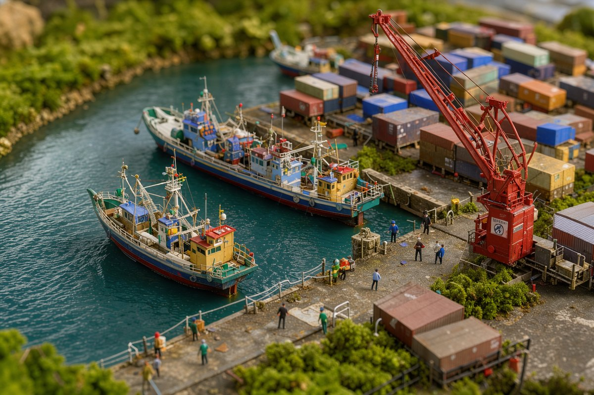</a> <small>Flux 3 Klein Edit · Built-in style: Tilt-shift, miniature look · “a busy harbour with colourful fishing boats, stacked containers, a red crane and tiny people on the quay”</small>

<small>13 more</small>
<a href="readme-images/examples/text-to-image-2.jpg">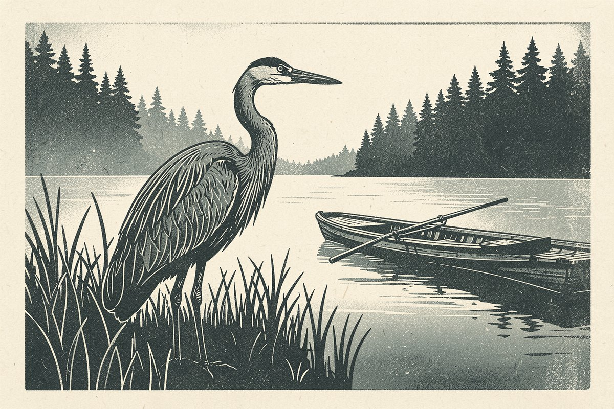</a> <small>Flux 2 Klein Edit · Built-in style: Linocut print · “a grey heron standing in reeds at a misty lake, a wooden rowing boat and distant pine trees”</small> <a href="readme-images/examples/text-to-image-3.jpg">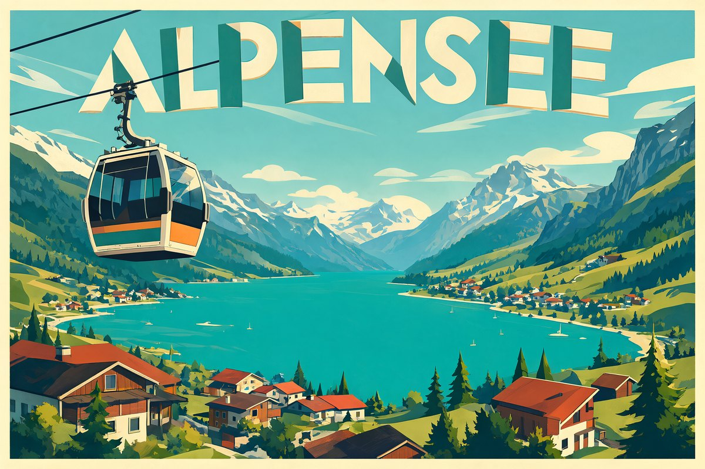</a> <small>Qwen Image 2.1 · Built-in style: Mid-century travel poster · “a cable car above an alpine village with a turquoise lake, the word &quot;ALPENSEE&quot; in large letters at the top”</small> <a href="readme-images/examples/text-to-image-4.jpg">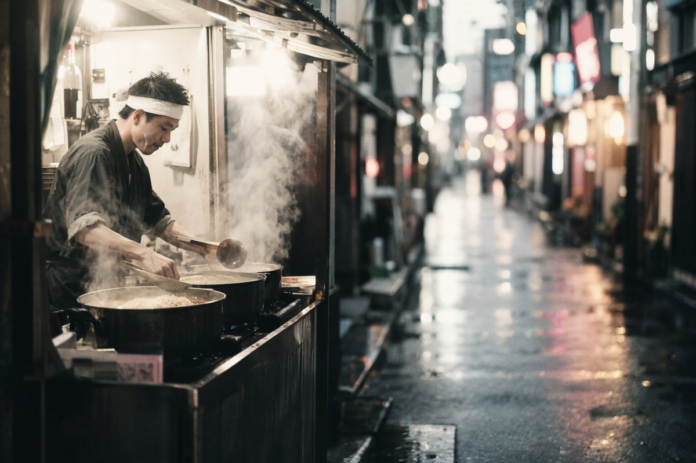</a> <small>MOSS Image · Built-in style: Neon city night, bokeh · “a ramen stall in a narrow alley, steam rising from the pots, a cook in a white headband”</small> <a href="readme-images/examples/text-to-image-5.jpg">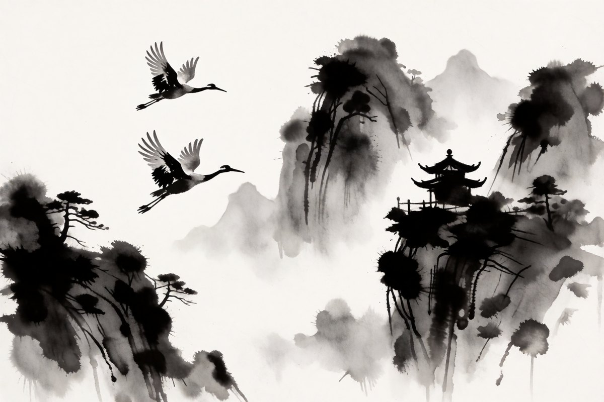</a> <small>Krea 2 Turbo · Built-in style: Japanese ink wash · “two cranes flying over misty mountains, a small temple on a cliff”</small> <a href="readme-images/examples/text-to-image-6.jpg">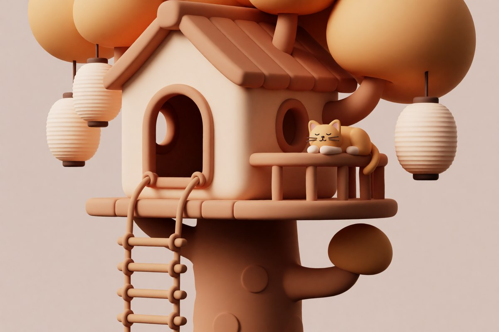</a> <small>Krea 2 Turbo · Built-in style: 3D clay render · “a cosy treehouse with a rope ladder, paper lanterns and a cat sleeping on the balcony”</small> <a href="readme-images/examples/text-to-image-7.jpg">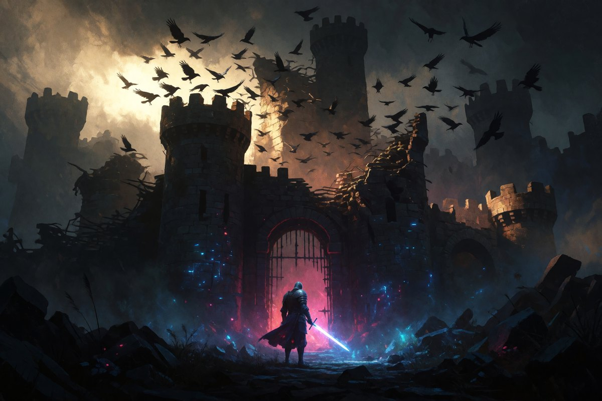</a> <small>Krea 2 Turbo · Built-in style: Dark fantasy, glowing neon · “a lone knight with a glowing sword at the gate of a ruined castle, ravens circling above the towers”</small> <a href="readme-images/examples/text-to-image-8.jpg">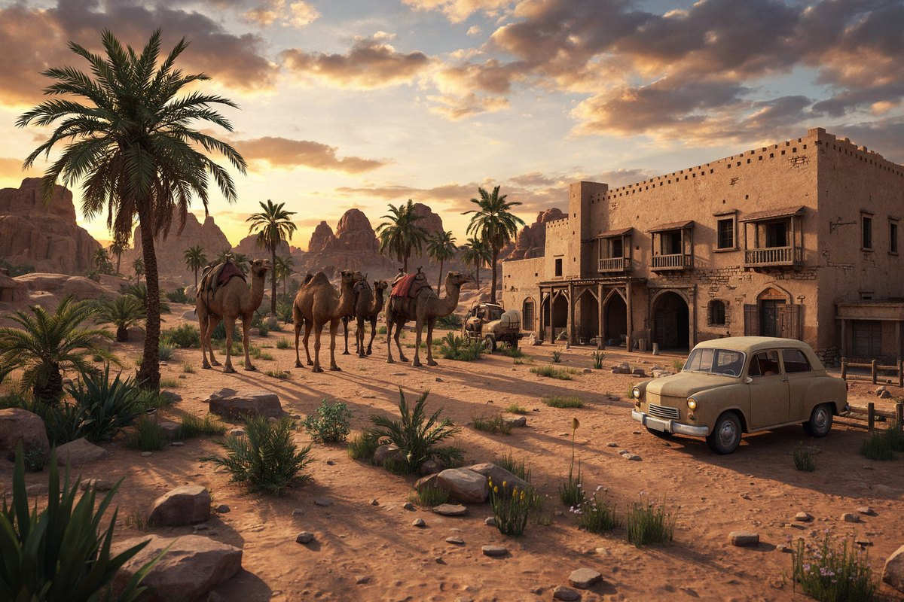</a> <small>Fibo 2.0 Edit Turbo · Built-in style: Low-poly game look · “a desert oasis with palm trees, a camel caravan and an old caravanserai”</small> <a href="readme-images/examples/text-to-image-9.jpg">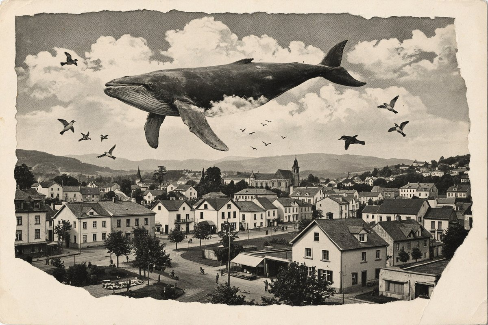</a> <small>Fibo 2.0 Edit Turbo · Built-in style: Vintage paper collage · “a whale swimming through the clouds above a small town, little birds around it”</small> <a href="readme-images/examples/text-to-image-11.jpg">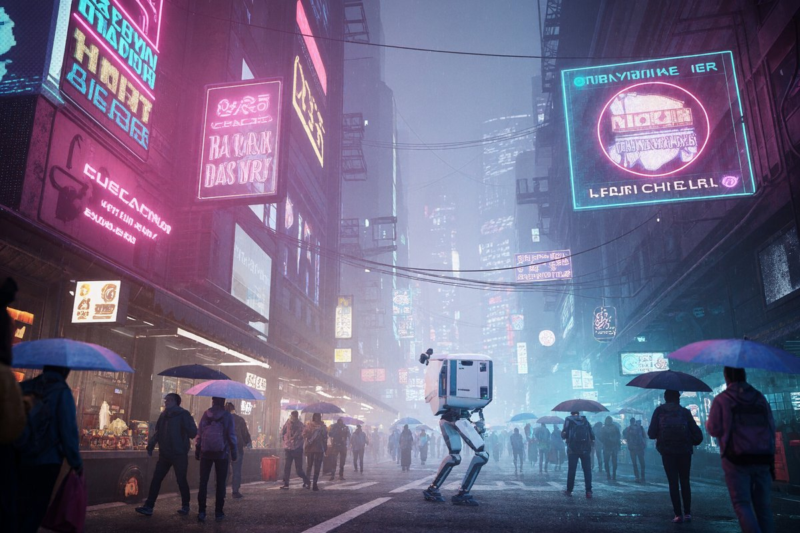</a> <small>MiniMax H3 Image · Built-in style: Cyberpunk city, neon rain · “a delivery robot crossing a crowded market street, holographic signs and people with umbrellas”</small> <a href="readme-images/examples/text-to-image-12.jpg">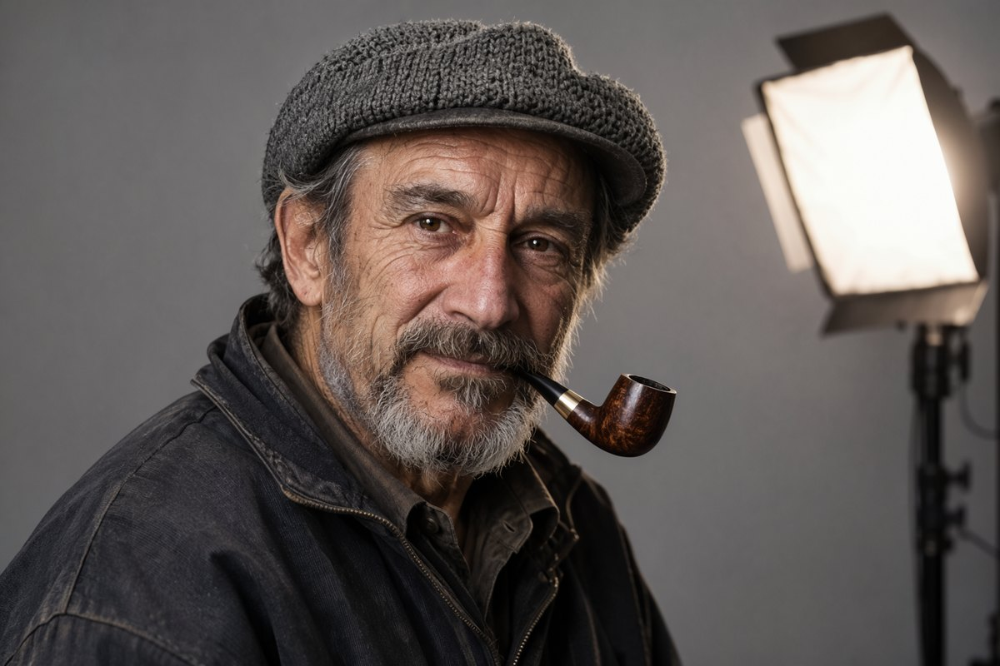</a> <small>MOSS Image · Built-in style: Studio portrait · “an old fisherman with a weathered face, a grey knitted cap and a wooden pipe”</small>  <small>MiniMax H3 Image · Built-in style: Business headshot · “a woman in her thirties with short black hair and round glasses, a navy blazer”</small> <a href="readme-images/examples/text-to-image-14.jpg">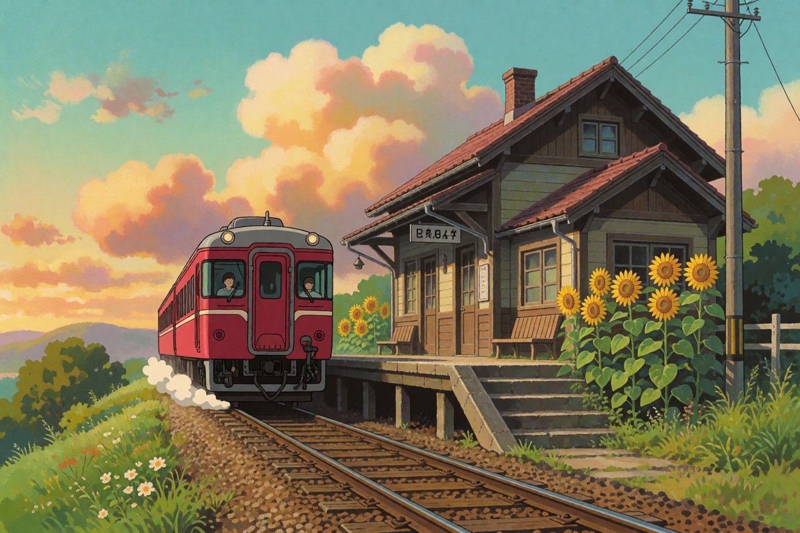</a> <small>Krea 2 Turbo · Built-in style: Anime background, golden sky · “a small railway station on a hill, a red train arriving, sunflowers along the platform”</small> <a href="readme-images/examples/text-to-image-15.jpg">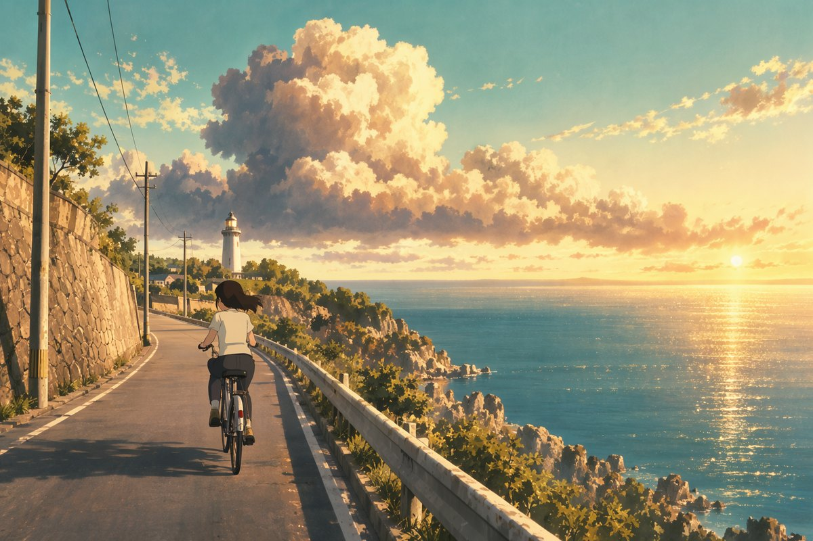</a> <small>MOSS Image · Built-in style: Anime background, golden sky · “a girl on a bicycle riding along a coastal road, a lighthouse and the sea below”</small> 
</td>
<td width="50%" valign="top"><b>Edit canvas</b> <a href="readme-images/examples/edit-canvas-1.jpg">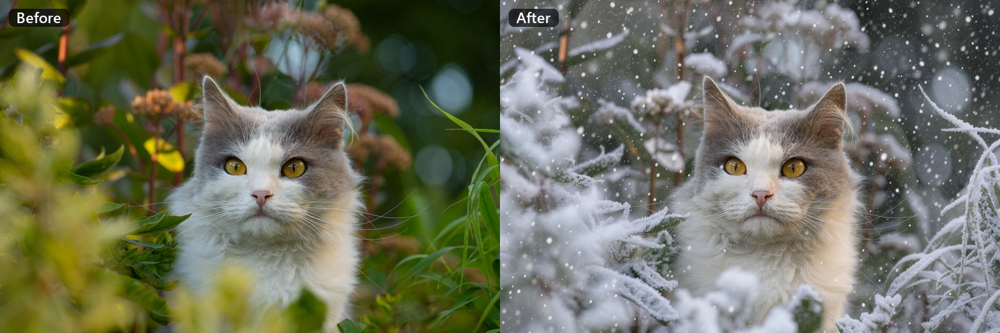</a> <small>Flux 3 Klein Edit · “Make it a snowy winter day, with snow on the leaves and soft falling snowflakes.”</small>

<small>3 more</small>
<a href="readme-images/examples/edit-canvas-2.jpg">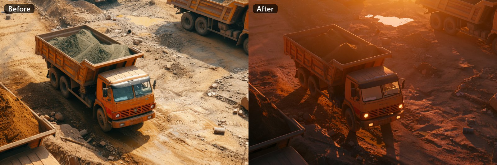</a> <small>Flux 2 Klein Edit · “Make it evening with warm golden sunset light and long shadows.”</small> <a href="readme-images/examples/edit-canvas-3.jpg">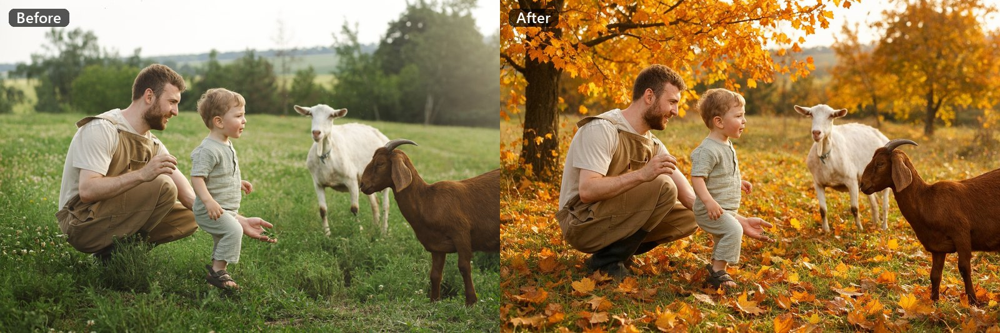</a> <small>Fibo 2.0 Edit Turbo · “Make it a sunny autumn day with orange and yellow leaves on the trees and in the grass.”</small> <a href="readme-images/examples/edit-canvas-4.jpg">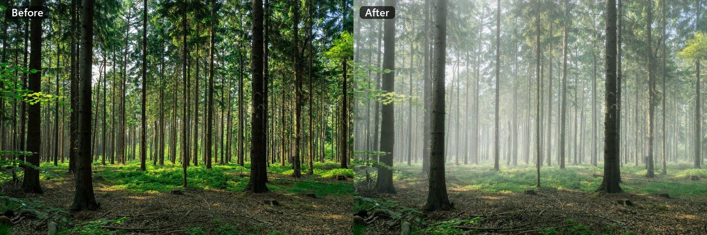</a> <small>Qwen Image 2.1 · “Add soft morning fog between the trees.”</small> 
</td>
</tr>
</table>
 
<table>
<tr>
<td width="50%" valign="top"><b>Edit canvas › Style prompts (built in)</b> <a href="readme-images/examples/edit-canvas-style-prompts-1.jpg">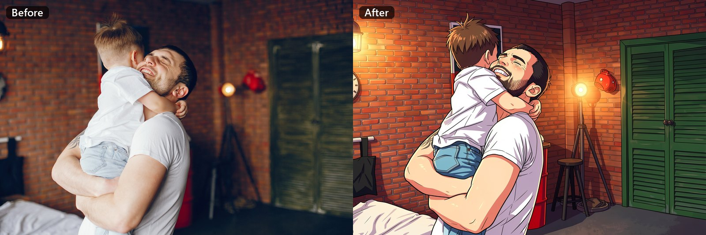</a> <small>Flux 2 Klein Edit · Built-in style: Anime</small>

<small>4 more</small>
<a href="readme-images/examples/edit-canvas-style-prompts-2.jpg">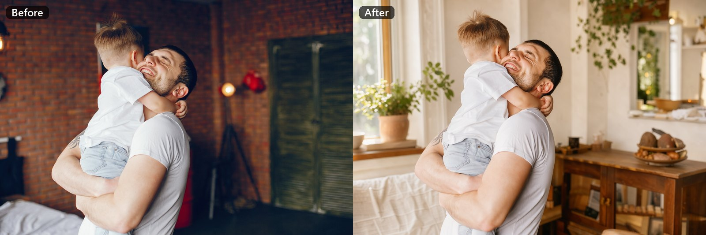</a> <small>Flux 3 Klein Edit · Built-in style: Stock photo (lifestyle)</small> <a href="readme-images/examples/edit-canvas-style-prompts-3.jpg">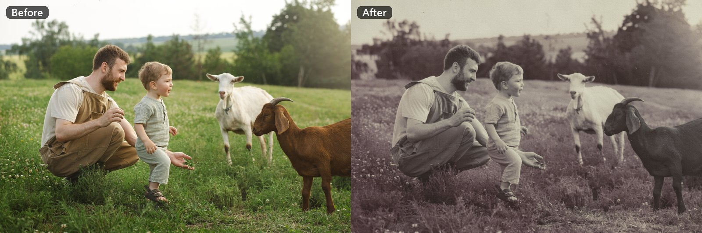</a> <small>Flux 3 Klein Edit · Built-in style: Vintage black-and-white photo</small> <a href="readme-images/examples/edit-canvas-style-prompts-4.jpg">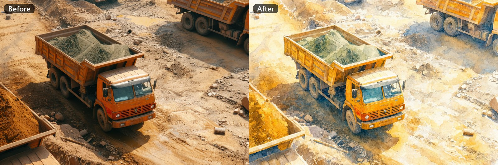</a> <small>Qwen Image 2.1 · Built-in style: Watercolor</small> <a href="readme-images/examples/edit-canvas-style-prompts-5.jpg">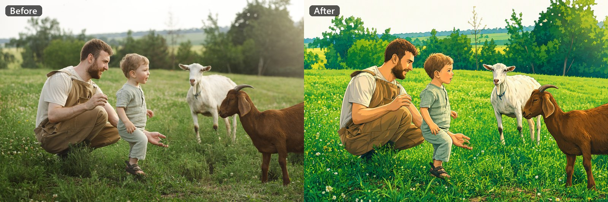</a> <small>Qwen Image 2.1 · Built-in style: Anime</small> 
</td>
<td width="50%" valign="top"><b>Fill Selection</b> <a href="readme-images/examples/fill-selection-1.jpg">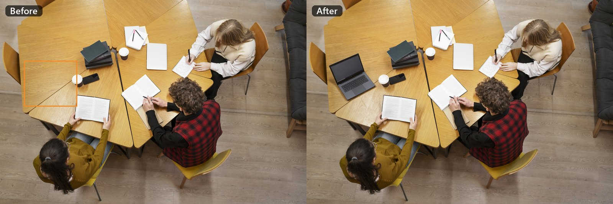</a> <small>Flux 3 Klein Edit · “an open laptop”</small>

<small>3 more</small>
<a href="readme-images/examples/fill-selection-2.jpg">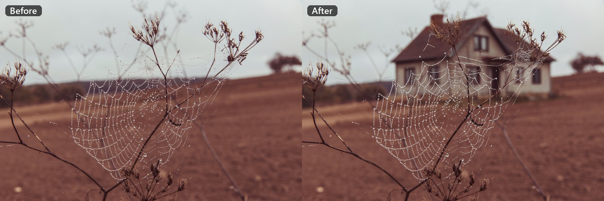</a> <small>Flux 3 Klein Edit · “insert a house behind the cobwebs, preserve the cobwebs”</small> <a href="readme-images/examples/fill-selection-3.jpg">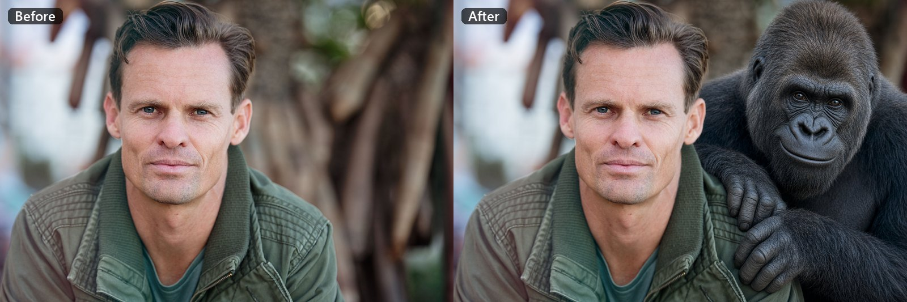</a> <small>Qwen Image 2.1 · “add a gorilla smiling into the camera, his arm on the man&#x27;s shoulder”</small> <a href="readme-images/examples/fill-selection-4.jpg">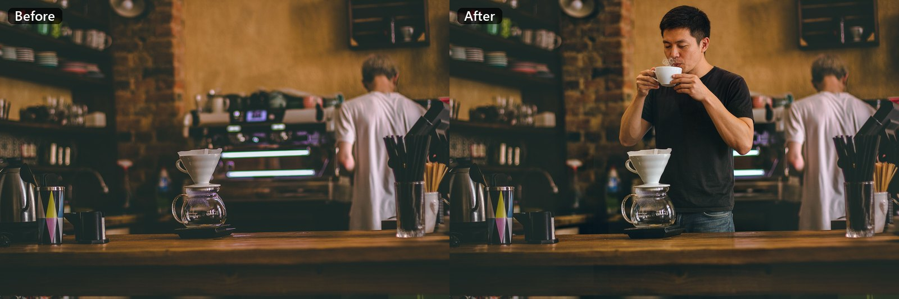</a> <small>Fibo 2.0 Edit Turbo · “add a guy with a coffee cup standing behind the table, drinking coffee”</small> 
</td>
</tr>
</table>
 
<table>
<tr>
<td width="50%" valign="top"><b>Remove Selection</b> <a href="readme-images/examples/remove-selection-1.jpg">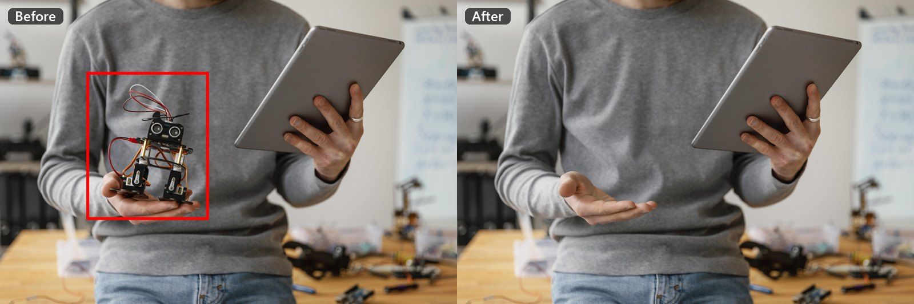</a> <small>Flux 2 Klein Edit · empty prompt</small>

<small>4 more</small>
<a href="readme-images/examples/remove-selection-2.jpg">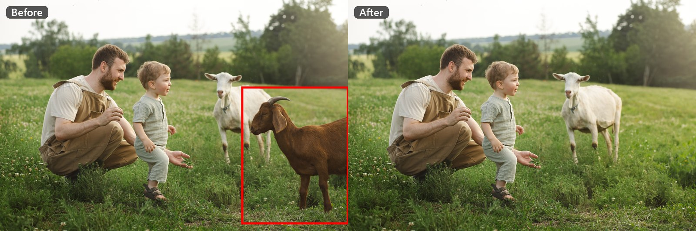</a> <small>Flux 3 Klein Edit · “the brown goat”</small> <a href="readme-images/examples/remove-selection-3.jpg">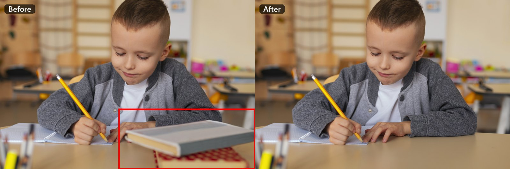</a> <small>Fibo 2.0 Edit Turbo · “the closed book”</small> <a href="readme-images/examples/remove-selection-4.jpg">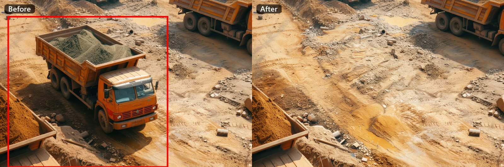</a> <small>Flux 3 Klein Edit · “the orange dump truck loaded with gravel”</small> <a href="readme-images/examples/remove-selection-5.jpg">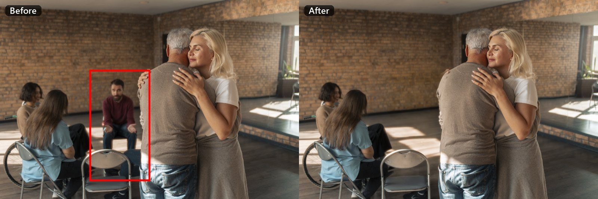</a> <small>Flux 3 Klein Edit · empty prompt</small> 
</td>
<td width="50%" valign="top"><b>Multi image edit</b> <a href="readme-images/examples/multi-image-edit-1.jpg">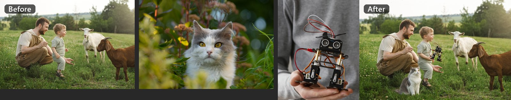</a> <small>Qwen Image 2.1 · “Add the cat from the second image, sitting in the grass in front of the boy, and let the boy hold the small robot from the third image.”</small></td>
</tr>
</table>
 
<table>
<tr>
<td width="50%" valign="top"><b>Sketch to image</b> <a href="readme-images/examples/sketch-to-image-1.jpg">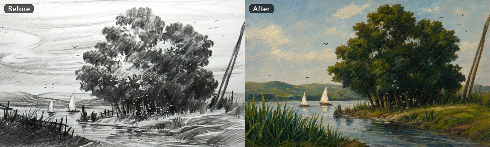</a> <small>Qwen Image 2.1 · Built-in style: Oil painting</small>

<small>4 more</small>
<a href="readme-images/examples/sketch-to-image-2.jpg">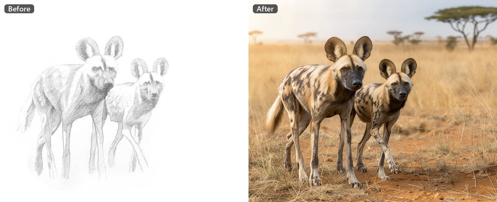</a> <small>Flux 3 Klein Edit · Built-in style: Stock photo (lifestyle)</small> <a href="readme-images/examples/sketch-to-image-3.jpg">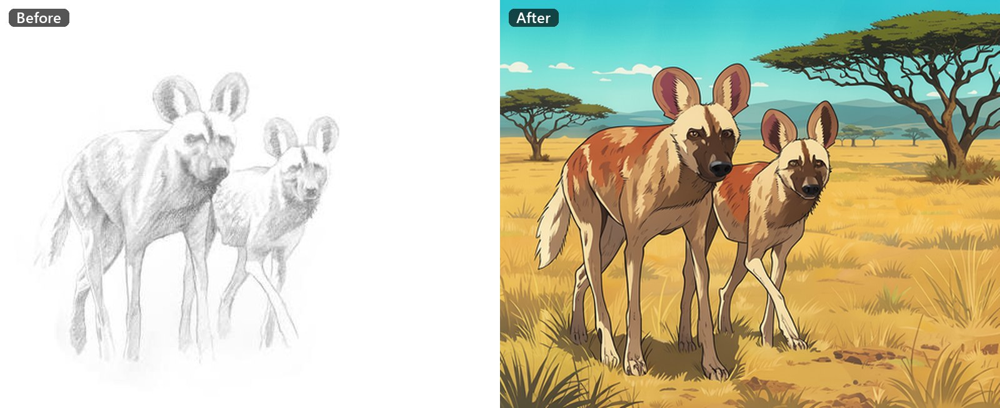</a> <small>Flux 3 Klein Edit · Built-in style: Anime</small> <a href="readme-images/examples/sketch-to-image-4.jpg">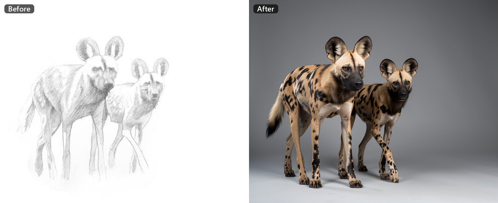</a> <small>Flux 2 Klein Edit · Built-in style: Studio portrait</small> <a href="readme-images/examples/sketch-to-image-5.jpg">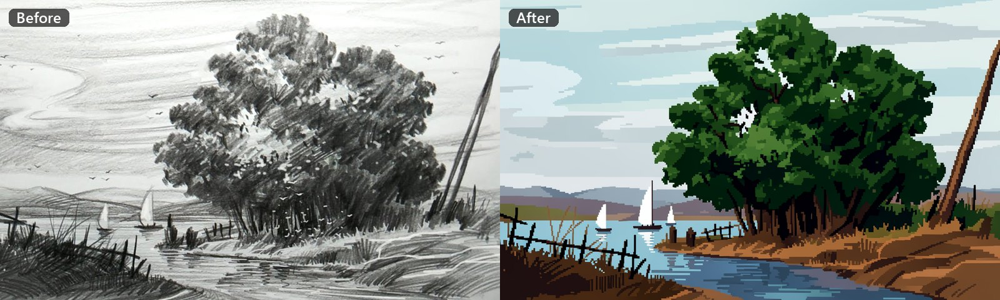</a> <small>Flux 2 Klein Edit · Built-in style: Pixel art</small> 
</td>
<td width="50%" valign="top"><b>Scribble on photo</b> <a href="readme-images/examples/scribble-on-photo-1.jpg">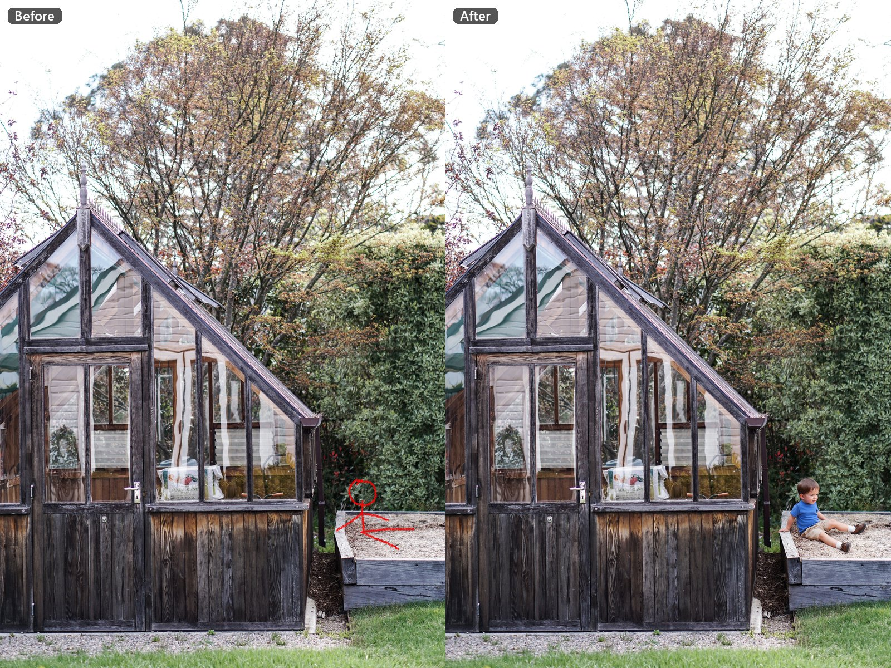</a> <small>Flux 3 Klein Edit · “a child”</small>

<small>6 more</small>
<a href="readme-images/examples/scribble-on-photo-2.jpg">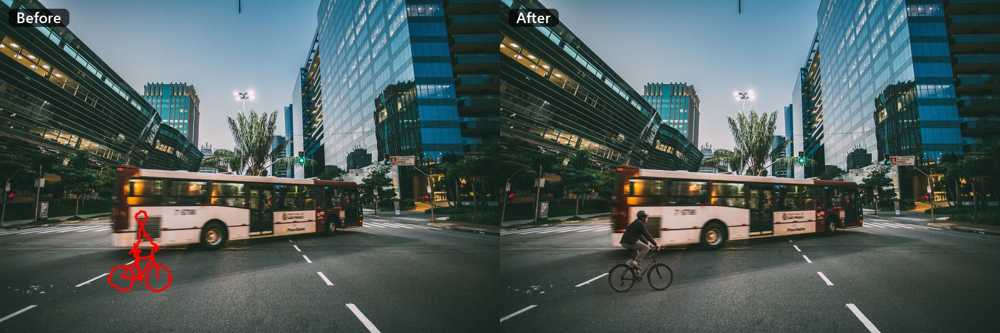</a> <small>Flux 3 Klein Edit · “a cyclist riding a bicycle”</small> <a href="readme-images/examples/scribble-on-photo-3.jpg">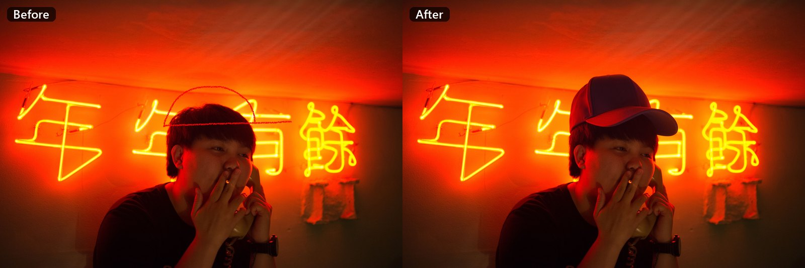</a> <small>Flux 2 Klein Edit · “a baseball cap”</small> <a href="readme-images/examples/scribble-on-photo-4.jpg">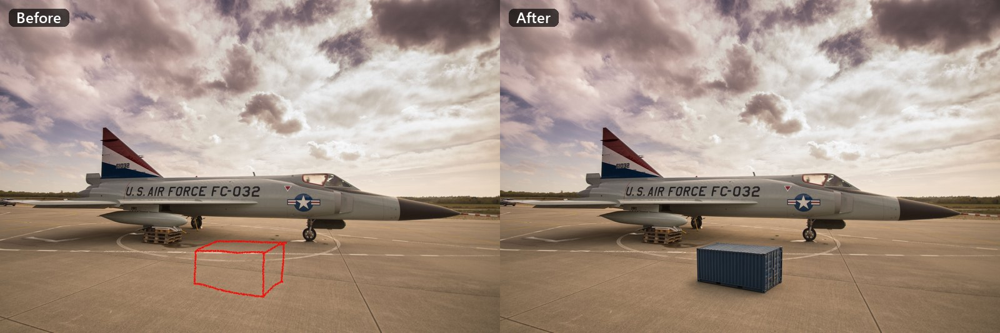</a> <small>Qwen Image 2.1 · “a shipping container”</small> <a href="readme-images/examples/scribble-on-photo-5.jpg">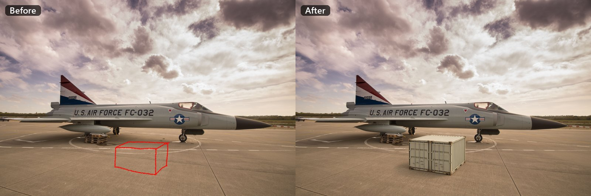</a> <small>Fibo 2.0 Edit Turbo · “a shipping container”</small> <a href="readme-images/examples/scribble-on-photo-6.jpg">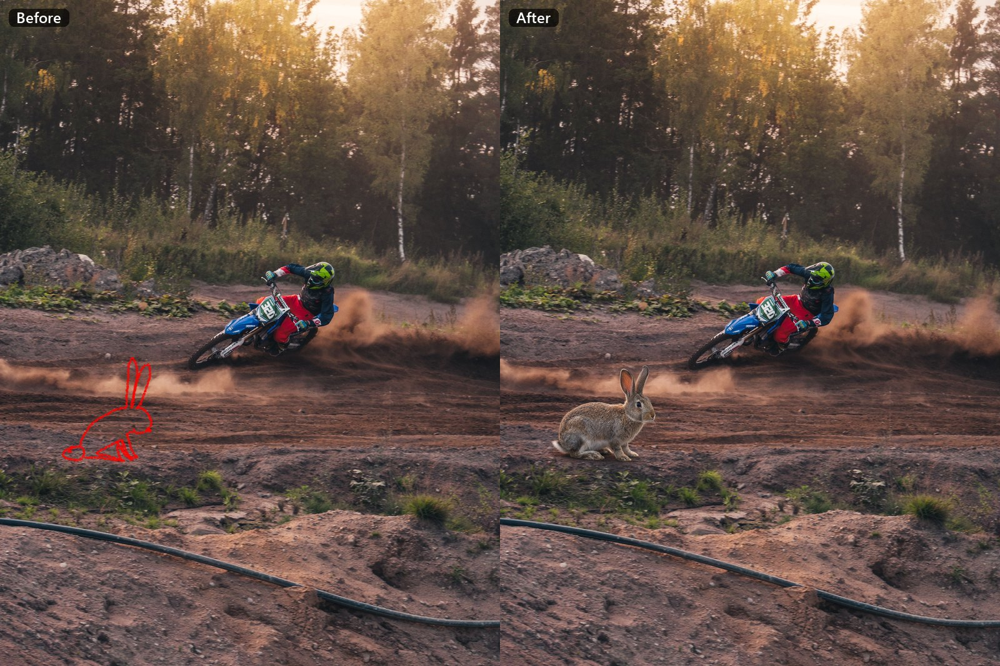</a> <small>Fibo 2.0 Edit Turbo · “a rabbit”</small> <a href="readme-images/examples/scribble-on-photo-7.jpg">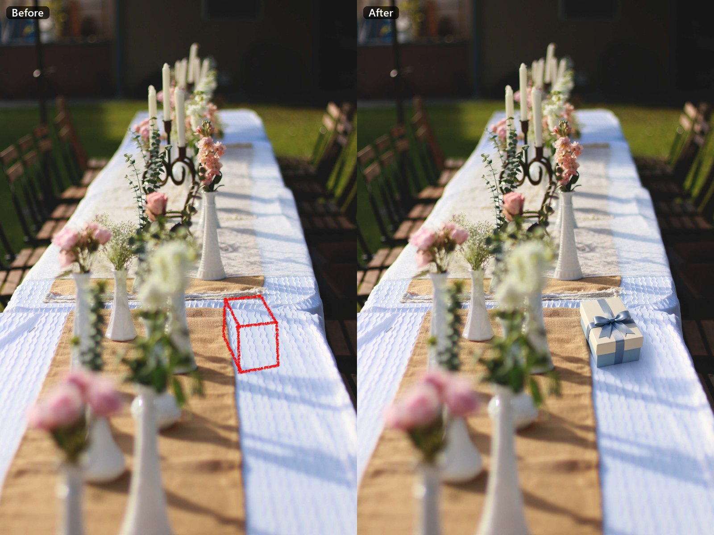</a> <small>Qwen Image 2.1 · “a gift box”</small> 
</td>
</tr>
</table>
 
<table>
<tr>
<td width="50%" valign="top"><b>Scribble with reference</b> <a href="readme-images/examples/scribble-with-reference-1.jpg">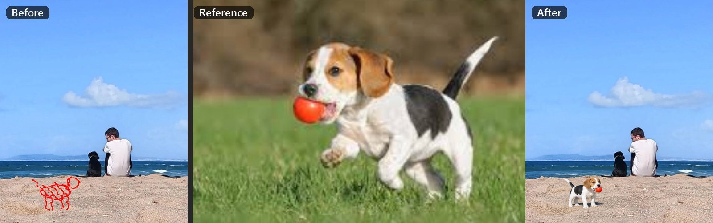</a> <small>Qwen Image 2.1 · “beagle dog”</small>

<small>2 more</small>
<a href="readme-images/examples/scribble-with-reference-2.jpg">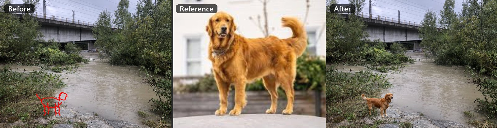</a> <small>Flux 3 Klein Edit · “golden retriever dog”</small> <a href="readme-images/examples/scribble-with-reference-3.jpg">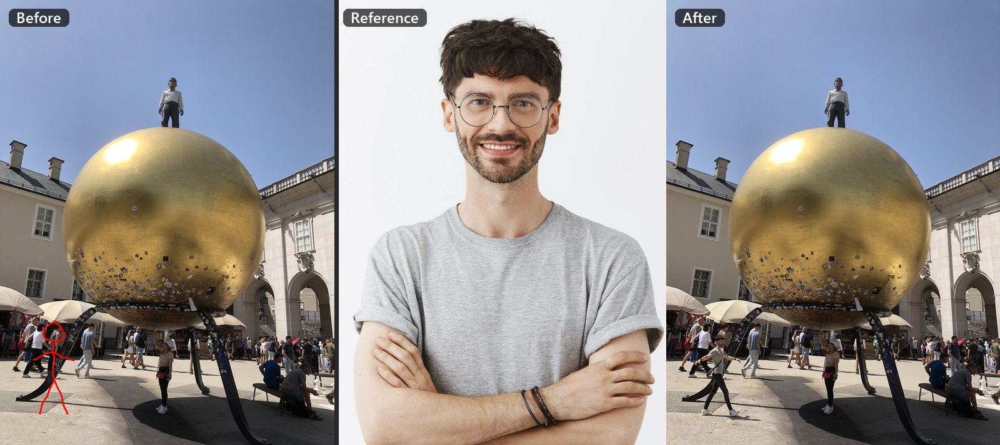</a> <small>Flux 2 Klein Edit · “man”</small> 
</td>
<td width="50%" valign="top"><b>Expand image</b> <a href="readme-images/examples/expand-image-1.jpg">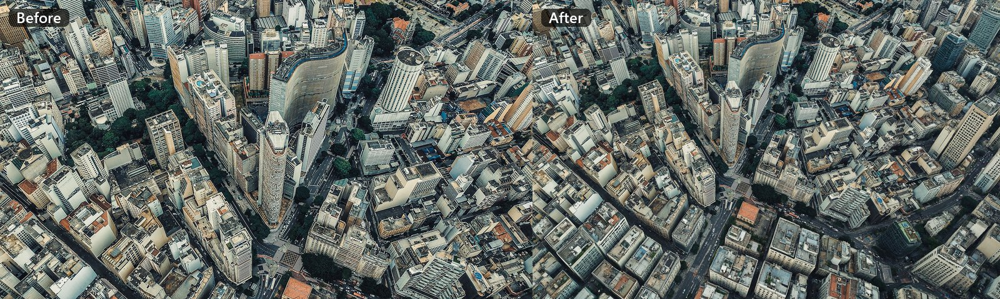</a> <small>Fibo 2.0 Edit Turbo · empty prompt</small></td>
</tr>
</table>

## More examples

Mixed functions, read in the order of the numbers.

<table>
<tr>
<td width="50%" valign="top"><a href="readme-images/examples/more-barn.webp">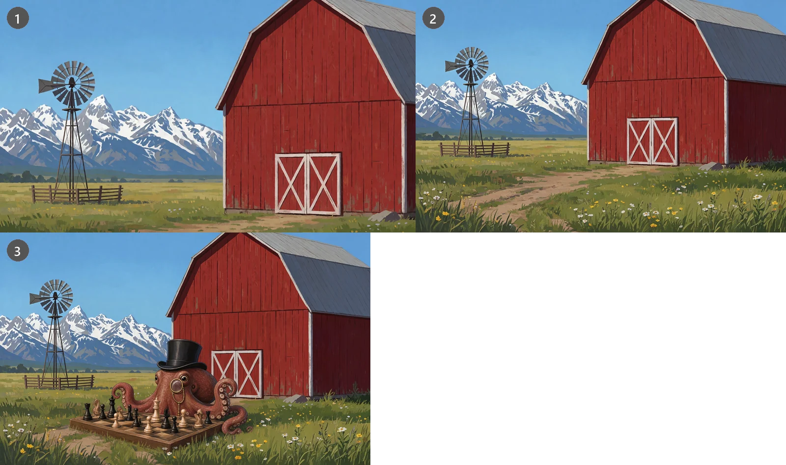</a> <small>1 Text to image · Krea 2 Turbo → 2 Expand image · Fibo 2.0 Edit Turbo → 3 Fill Selection · Qwen Image 2.1</small></td>
<td width="50%" valign="top"><a href="readme-images/examples/more-beach-chair.webp">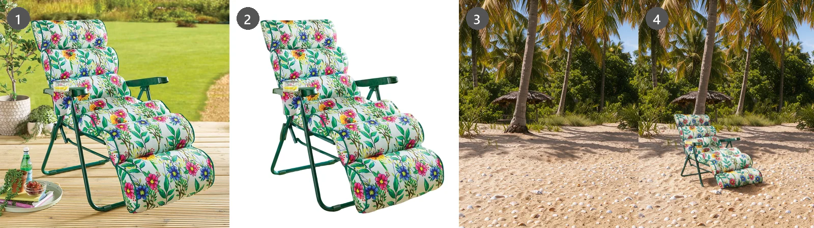</a> <small>1 Reference → 2 Remove background → 3 Text to image · Flux 3 Klein → 4 Multi image edit · Flux 3 Klein</small></td>
</tr>
</table>
 
<table>
<tr>
<td width="50%" valign="top"> <small>1 Start → 2 Sketch to image → 3 Scribble on photo</small></td>
<td width="50%" valign="top"> <small>1 Text to image · MOSS Image → 2 Fill Selection · Fibo 2.0 Edit Turbo → 3 Fill Selection · Fibo 2.0 Edit Turbo → 4 Fill Selection · Fibo 2.0 Edit Turbo</small></td>
</tr>
</table>
 
<table>
<tr>
<td width="50%" valign="top"> <small>1 Text to image · Fibo 2.0 Edit Turbo → 2 Fill Selection · Fibo 2.0 Edit Turbo → 3 Fill Selection · Fibo 2.0 Edit Turbo → 4 Fill Selection · Fibo 2.0 Edit Turbo</small></td>
<td width="50%" valign="top"> <small>1 Start → 2 Scribble with reference · Flux 3 Klein</small></td>
</tr>
</table>
 
<table>
<tr>
<td width="50%" valign="top"> <small>1 Start → 2 Fill Selection · Fibo 2.0 Edit Turbo → 3 Expand image · Qwen Image 2.1 → 4 Remove Selection · Fibo 2.0 Edit Turbo</small></td>
<td width="50%" valign="top"> <small>1 Reference → 2 Start → 3 Multi image edit · Flux 3 Klein → 4 Multi image edit · Qwen Image 2.1</small></td>
</tr>
</table>
 
<table>
<tr>
<td width="50%" valign="top"> <small>1 Start → 2 Remove Selection · Flux 2 Klein → 3 Fill Selection · Fibo 2.0 Edit Turbo</small></td>
<td width="50%"></td>
</tr>
</table>

Photos: Magnific, Freepik, Pexels

[← Back to the README](README.md)
