<div align="center">

# PxC

*PhotoCraft x ComfyUI*

[](../../actions/workflows/install-matrix.yml)
[](#license)
[](#install-on-windows)
[](#install-on-windows)

**Photoshop-style generative AI for PhotoCraft, running on your own PC.**
Pick a function, type a prompt, press Generate: the result arrives as a new layer in your document.


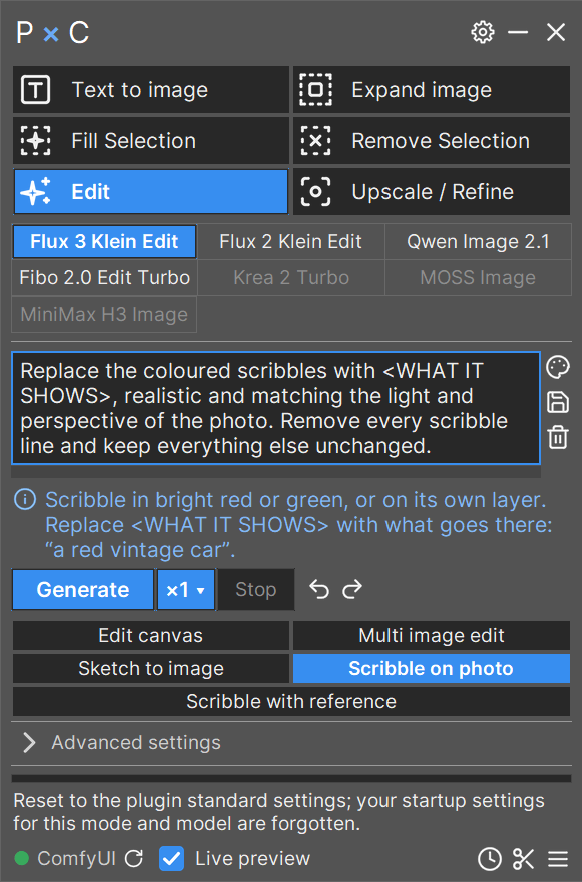

Tested: Windows 11 · PhotoCraft 0.23.1 · ComfyUI 0.45.0

[Examples](#examples) · [Before you start](#before-you-start) · [Install on Windows](#install-on-windows) · [Install on Linux](#install-on-linux) · [Model downloads](#model-downloads) · [Functions](#functions) · [Help](#help) · [Technical details](#technical-details)

</div>

<!-- examples:start -->
<a id="examples"></a>
<details>
<summary><h2>Examples</h2></summary>

<table>
<tr>
<td width="50%" valign="top"><b>Text to image</b><br><a href="readme-images/examples/text-to-image-1.jpg"></a><br><small>Flux 3 Klein Edit · Built-in style: Tilt-shift, miniature look · “a busy harbour with colourful fishing boats, stacked containers, a red crane and tiny people on the quay”</small><details><summary><small>14 more</small></summary><a href="readme-images/examples/text-to-image-2.jpg">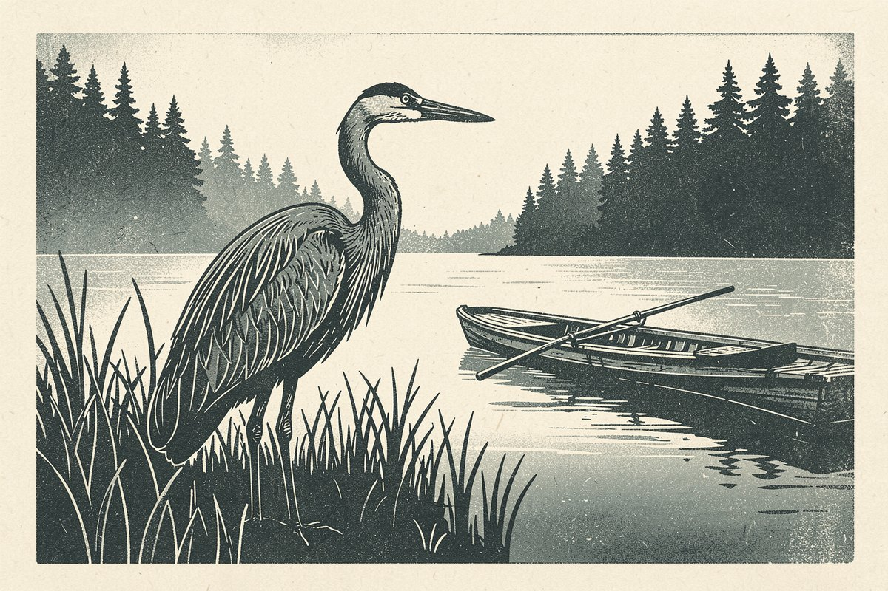</a><br><small>Flux 2 Klein Edit · Built-in style: Linocut print · “a grey heron standing in reeds at a misty lake, a wooden rowing boat and distant pine trees”</small><br><a href="readme-images/examples/text-to-image-3.jpg">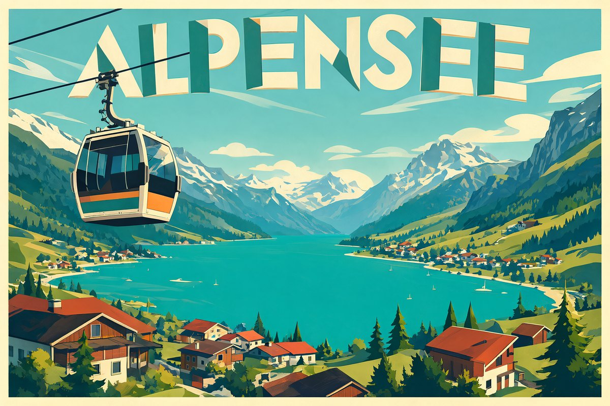</a><br><small>Qwen Image 2.1 · Built-in style: Mid-century travel poster · “a cable car above an alpine village with a turquoise lake, the word &quot;ALPENSEE&quot; in large letters at the top”</small><br><a href="readme-images/examples/text-to-image-4.jpg"></a><br><small>MOSS Image · Built-in style: Neon city night, bokeh · “a ramen stall in a narrow alley, steam rising from the pots, a cook in a white headband”</small><br><a href="readme-images/examples/text-to-image-5.jpg"></a><br><small>Krea 2 Turbo · Built-in style: Japanese ink wash · “two cranes flying over misty mountains, a small temple on a cliff”</small><br><a href="readme-images/examples/text-to-image-6.jpg">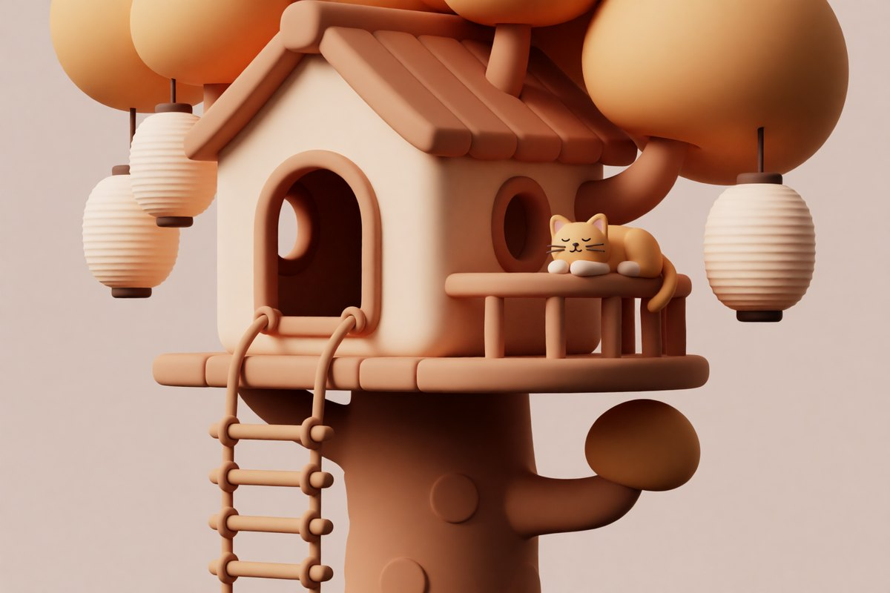</a><br><small>Krea 2 Turbo · Built-in style: 3D clay render · “a cosy treehouse with a rope ladder, paper lanterns and a cat sleeping on the balcony”</small><br><a href="readme-images/examples/text-to-image-7.jpg">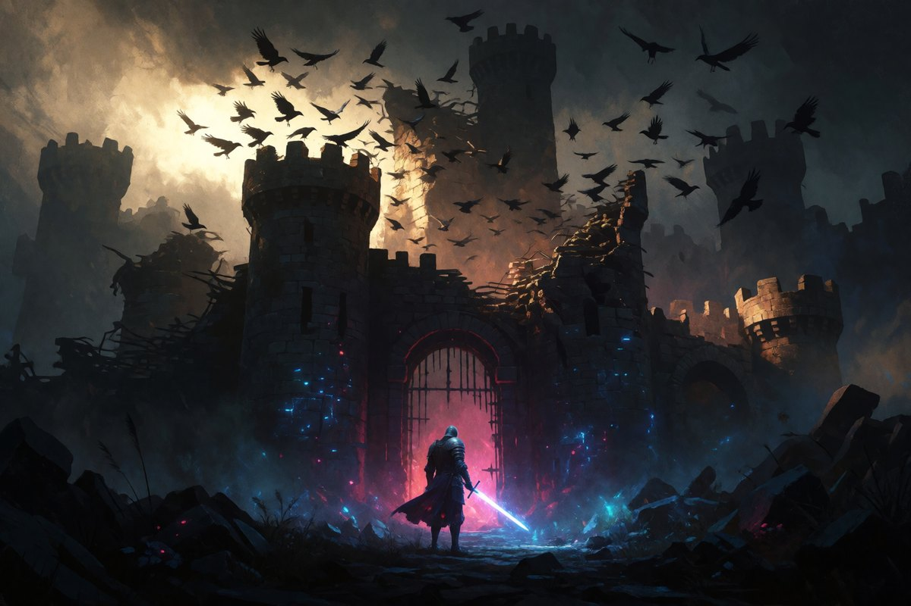</a><br><small>Krea 2 Turbo · Built-in style: Dark fantasy, glowing neon · “a lone knight with a glowing sword at the gate of a ruined castle, ravens circling above the towers”</small><br><a href="readme-images/examples/text-to-image-8.jpg"></a><br><small>Fibo 2.0 Edit Turbo · Built-in style: Low-poly game look · “a desert oasis with palm trees, a camel caravan and an old caravanserai”</small><br><a href="readme-images/examples/text-to-image-9.jpg">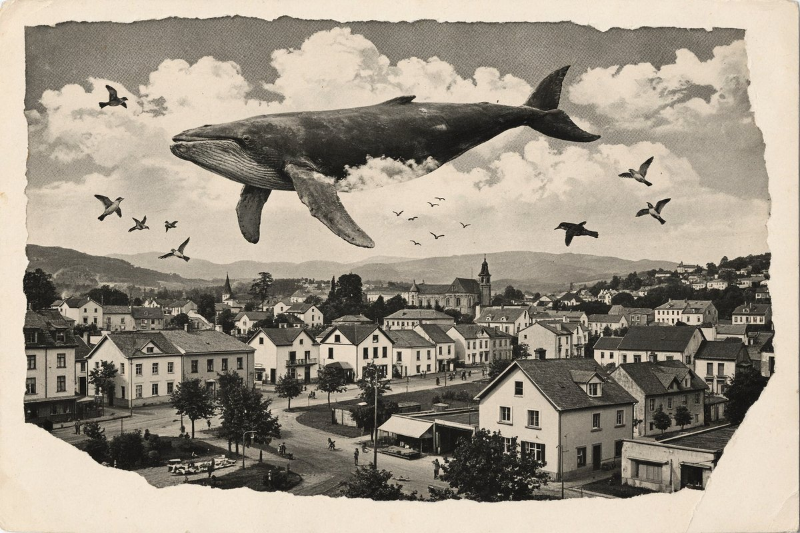</a><br><small>Fibo 2.0 Edit Turbo · Built-in style: Vintage paper collage · “a whale swimming through the clouds above a small town, little birds around it”</small><br><a href="readme-images/examples/text-to-image-10.jpg"></a><br><small>MiniMax H3 Image · Built-in style: Oil painting, 19th-century realism · “a blacksmith at his anvil, sparks flying, tools hanging on the wall behind him”</small><br><a href="readme-images/examples/text-to-image-11.jpg">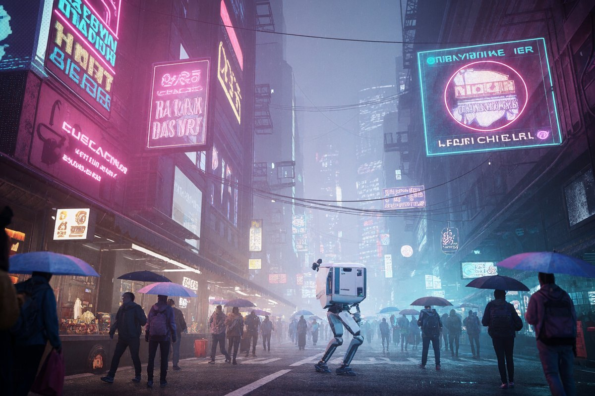</a><br><small>MiniMax H3 Image · Built-in style: Cyberpunk city, neon rain · “a delivery robot crossing a crowded market street, holographic signs and people with umbrellas”</small><br><a href="readme-images/examples/text-to-image-12.jpg">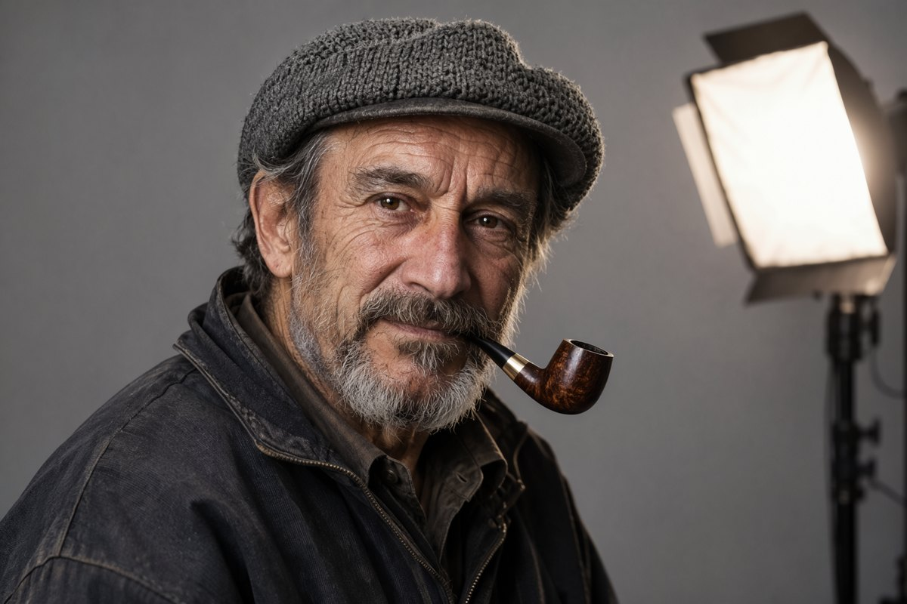</a><br><small>MOSS Image · Built-in style: Studio portrait · “an old fisherman with a weathered face, a grey knitted cap and a wooden pipe”</small><br><a href="readme-images/examples/text-to-image-13.jpg"></a><br><small>MiniMax H3 Image · Built-in style: Business headshot · “a woman in her thirties with short black hair and round glasses, a navy blazer”</small><br><a href="readme-images/examples/text-to-image-14.jpg">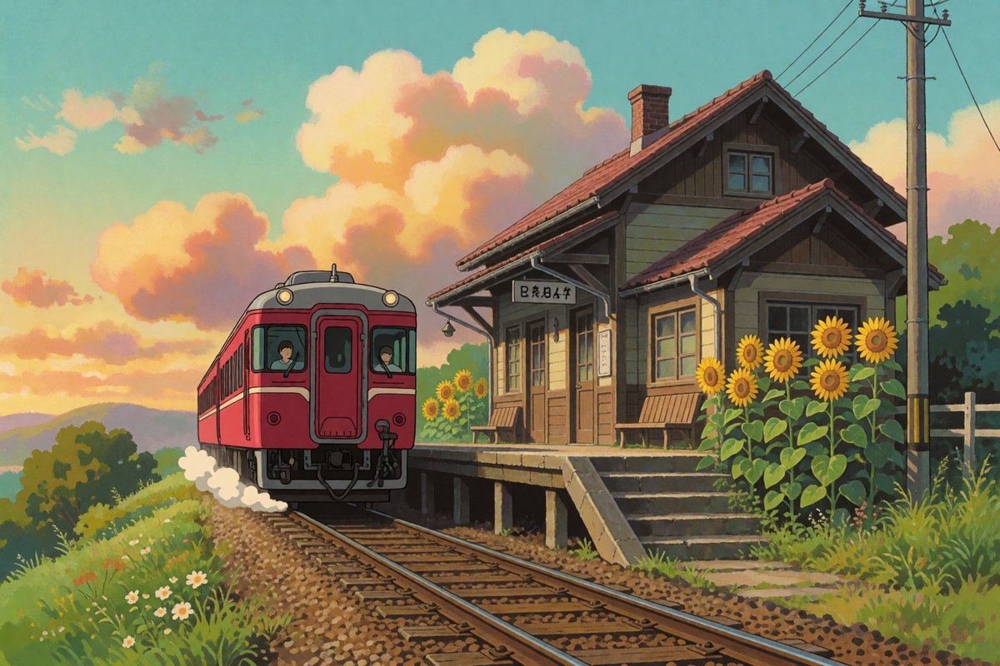</a><br><small>Krea 2 Turbo · Built-in style: Anime background, golden sky · “a small railway station on a hill, a red train arriving, sunflowers along the platform”</small><br><a href="readme-images/examples/text-to-image-15.jpg"></a><br><small>MOSS Image · Built-in style: Anime background, golden sky · “a girl on a bicycle riding along a coastal road, a lighthouse and the sea below”</small><br></details></td>
<td width="50%" valign="top"><b>Expand image</b><br><a href="readme-images/examples/expand-image-1.jpg">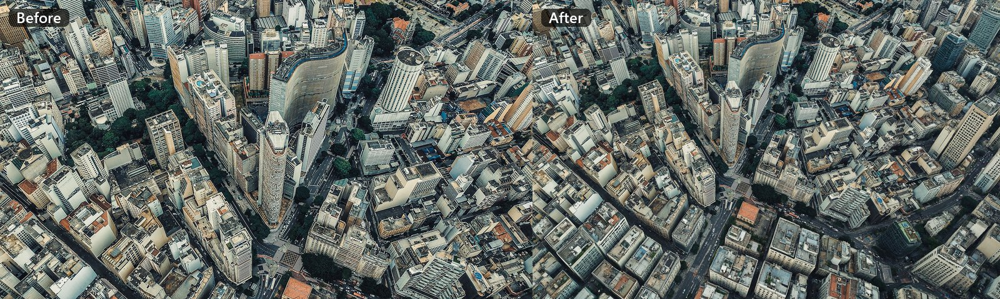</a><br><small>Fibo 2.0 Edit Turbo · empty prompt</small></td>
</tr>
</table>
<br>
<table>
<tr>
<td width="50%" valign="top"><b>Fill Selection</b><br><a href="readme-images/examples/fill-selection-1.jpg"></a><br><small>Flux 3 Klein Edit · “an open laptop”</small><details><summary><small>3 more</small></summary><a href="readme-images/examples/fill-selection-2.jpg">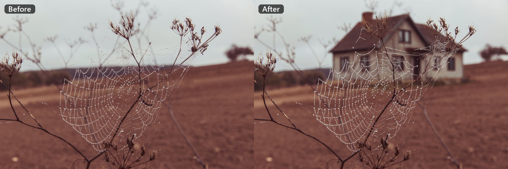</a><br><small>Flux 3 Klein Edit · “insert a house behind the cobwebs, preserve the cobwebs”</small><br><a href="readme-images/examples/fill-selection-3.jpg">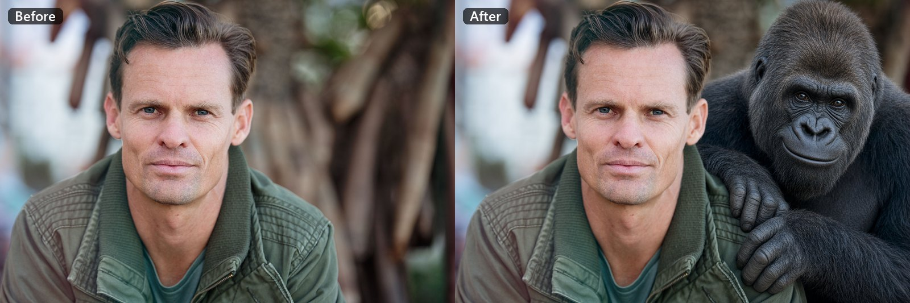</a><br><small>Qwen Image 2.1 · “add a gorilla smiling into the camera, his arm on the man&#x27;s shoulder”</small><br><a href="readme-images/examples/fill-selection-4.jpg"></a><br><small>Fibo 2.0 Edit Turbo · “add a guy with a coffee cup standing behind the table, drinking coffee”</small><br></details></td>
<td width="50%" valign="top"><b>Remove Selection</b><br><a href="readme-images/examples/remove-selection-1.jpg">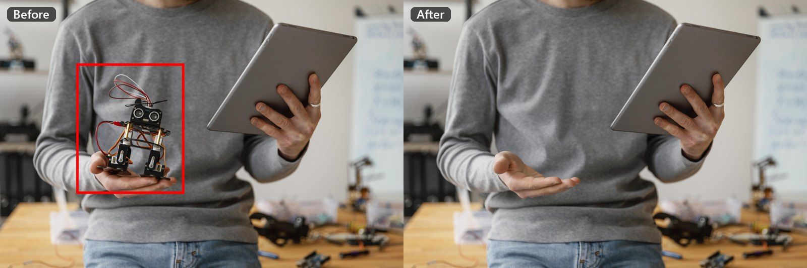</a><br><small>Flux 2 Klein Edit · empty prompt</small><details><summary><small>4 more</small></summary><a href="readme-images/examples/remove-selection-2.jpg">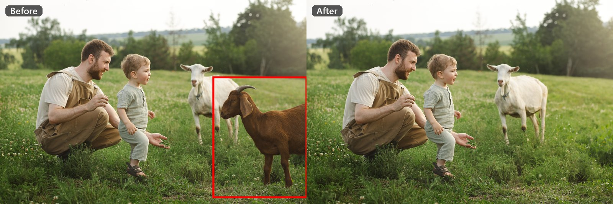</a><br><small>Flux 3 Klein Edit · “the brown goat”</small><br><a href="readme-images/examples/remove-selection-3.jpg">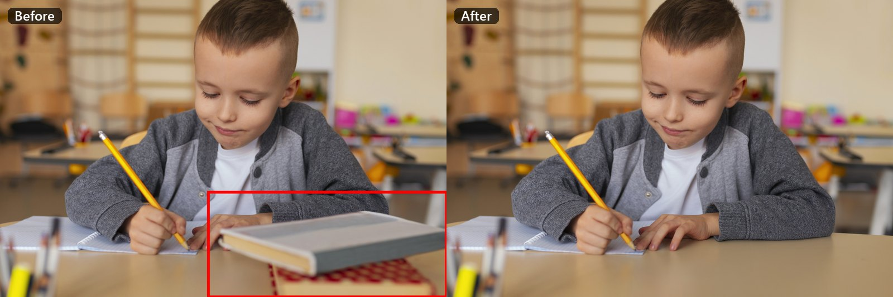</a><br><small>Fibo 2.0 Edit Turbo · “the closed book”</small><br><a href="readme-images/examples/remove-selection-4.jpg">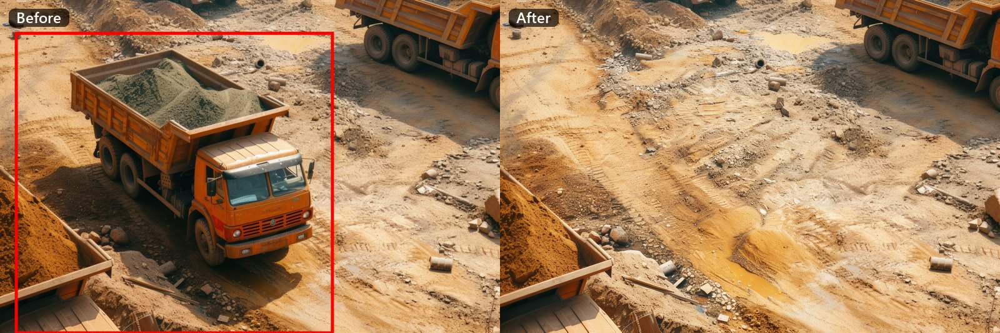</a><br><small>Flux 3 Klein Edit · “the orange dump truck loaded with gravel”</small><br><a href="readme-images/examples/remove-selection-5.jpg">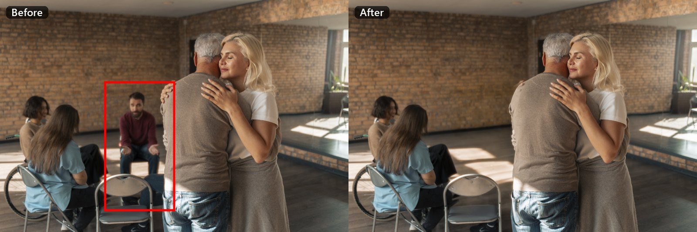</a><br><small>Flux 3 Klein Edit · empty prompt</small><br></details></td>
</tr>
</table>
<br>
<table>
<tr>
<td width="50%" valign="top"><b>Edit canvas</b><br><a href="readme-images/examples/edit-canvas-1.jpg">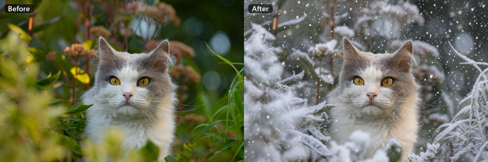</a><br><small>Flux 3 Klein Edit · “Make it a snowy winter day, with snow on the leaves and soft falling snowflakes.”</small><details><summary><small>3 more</small></summary><a href="readme-images/examples/edit-canvas-2.jpg">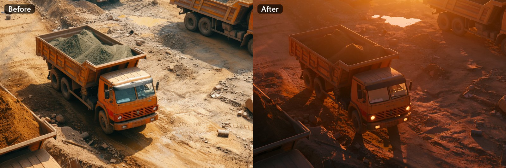</a><br><small>Flux 2 Klein Edit · “Make it evening with warm golden sunset light and long shadows.”</small><br><a href="readme-images/examples/edit-canvas-3.jpg">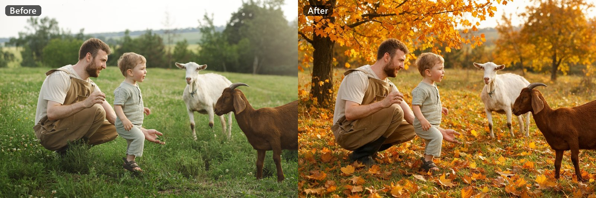</a><br><small>Fibo 2.0 Edit Turbo · “Make it a sunny autumn day with orange and yellow leaves on the trees and in the grass.”</small><br><a href="readme-images/examples/edit-canvas-4.jpg">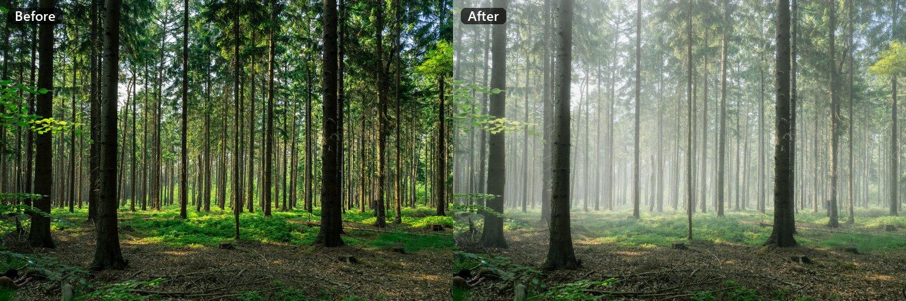</a><br><small>Qwen Image 2.1 · “Add soft morning fog between the trees.”</small><br></details></td>
<td width="50%" valign="top"><b>Edit canvas › Style prompts (built in)</b><br><a href="readme-images/examples/edit-canvas-style-prompts-1.jpg">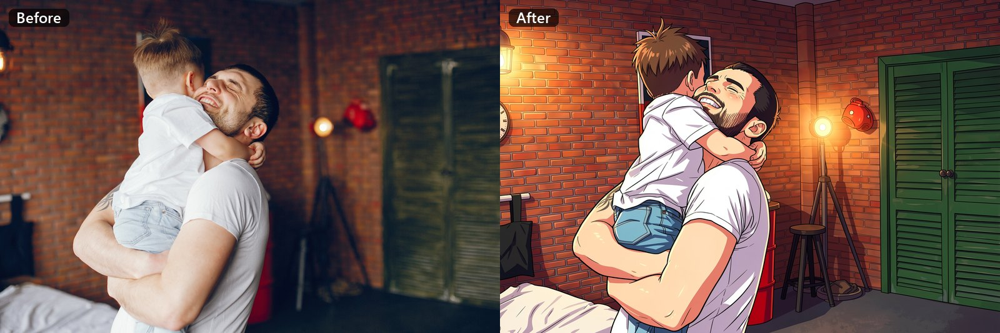</a><br><small>Flux 2 Klein Edit · Built-in style: Anime</small><details><summary><small>4 more</small></summary><a href="readme-images/examples/edit-canvas-style-prompts-2.jpg">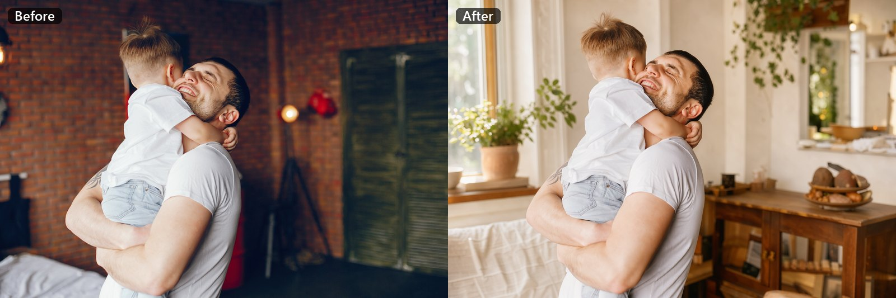</a><br><small>Flux 3 Klein Edit · Built-in style: Stock photo (lifestyle)</small><br><a href="readme-images/examples/edit-canvas-style-prompts-3.jpg">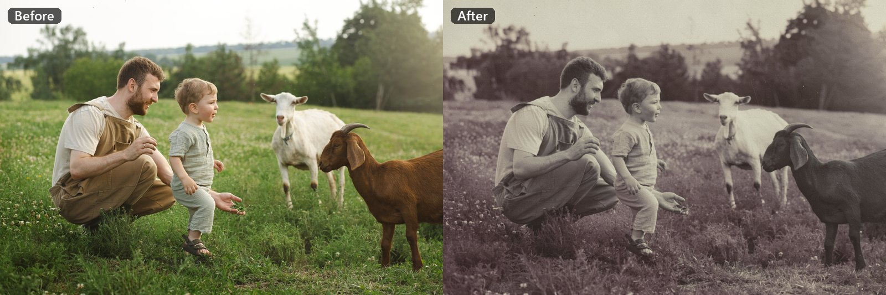</a><br><small>Flux 3 Klein Edit · Built-in style: Vintage black-and-white photo</small><br><a href="readme-images/examples/edit-canvas-style-prompts-4.jpg"></a><br><small>Qwen Image 2.1 · Built-in style: Watercolor</small><br><a href="readme-images/examples/edit-canvas-style-prompts-5.jpg">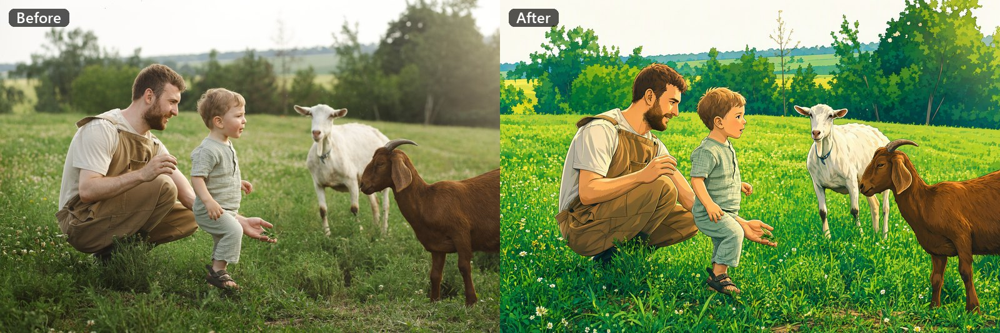</a><br><small>Qwen Image 2.1 · Built-in style: Anime</small><br></details></td>
</tr>
</table>
<br>
<table>
<tr>
<td width="50%" valign="top"><b>Multi image edit</b><br><a href="readme-images/examples/multi-image-edit-1.jpg">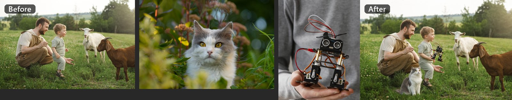</a><br><small>Qwen Image 2.1 · “Add the cat from the second image, sitting in the grass in front of the boy, and let the boy hold the small robot from the third image.”</small></td>
<td width="50%" valign="top"><b>Sketch to image</b><br><a href="readme-images/examples/sketch-to-image-1.jpg">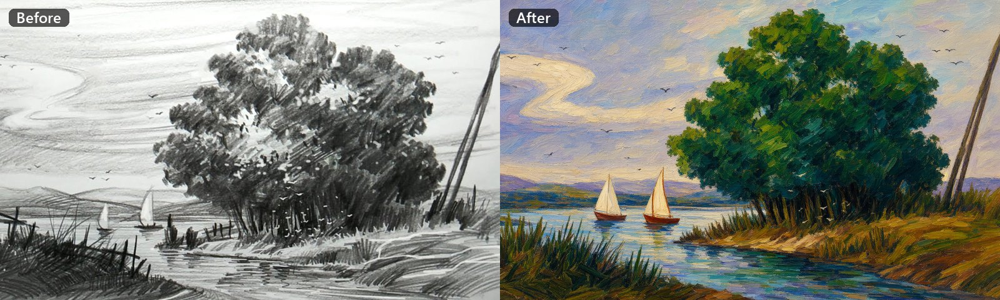</a><br><small>Qwen Image 2.1 · Built-in style: Oil painting</small><details><summary><small>4 more</small></summary><a href="readme-images/examples/sketch-to-image-2.jpg">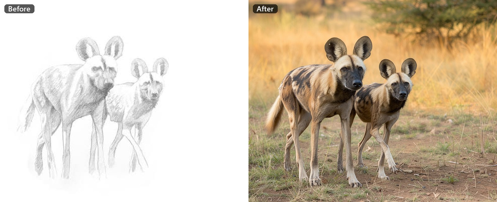</a><br><small>Flux 3 Klein Edit · Built-in style: Stock photo (lifestyle)</small><br><a href="readme-images/examples/sketch-to-image-3.jpg">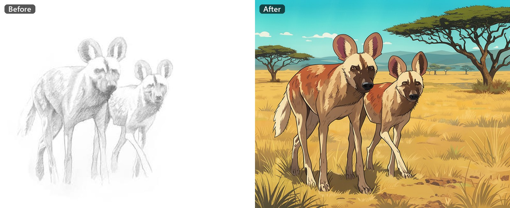</a><br><small>Flux 3 Klein Edit · Built-in style: Anime</small><br><a href="readme-images/examples/sketch-to-image-4.jpg">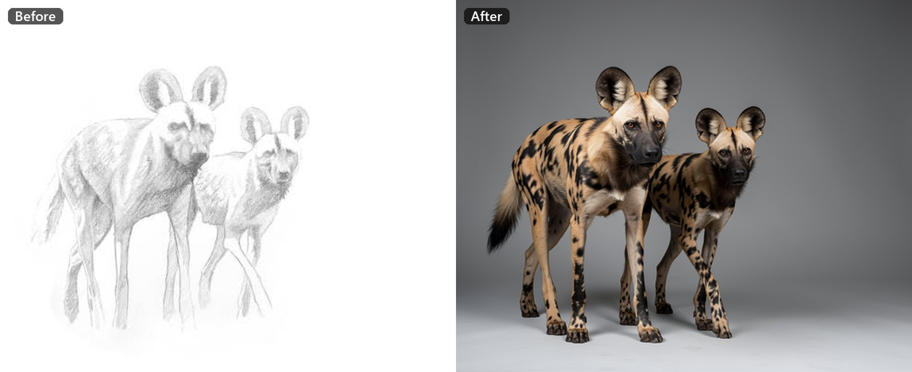</a><br><small>Flux 2 Klein Edit · Built-in style: Studio portrait</small><br><a href="readme-images/examples/sketch-to-image-5.jpg">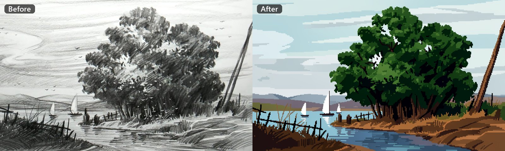</a><br><small>Flux 2 Klein Edit · Built-in style: Pixel art</small><br></details></td>
</tr>
</table>
<br>
<table>
<tr>
<td width="50%" valign="top"><b>Scribble on photo</b><br><a href="readme-images/examples/scribble-on-photo-1.jpg">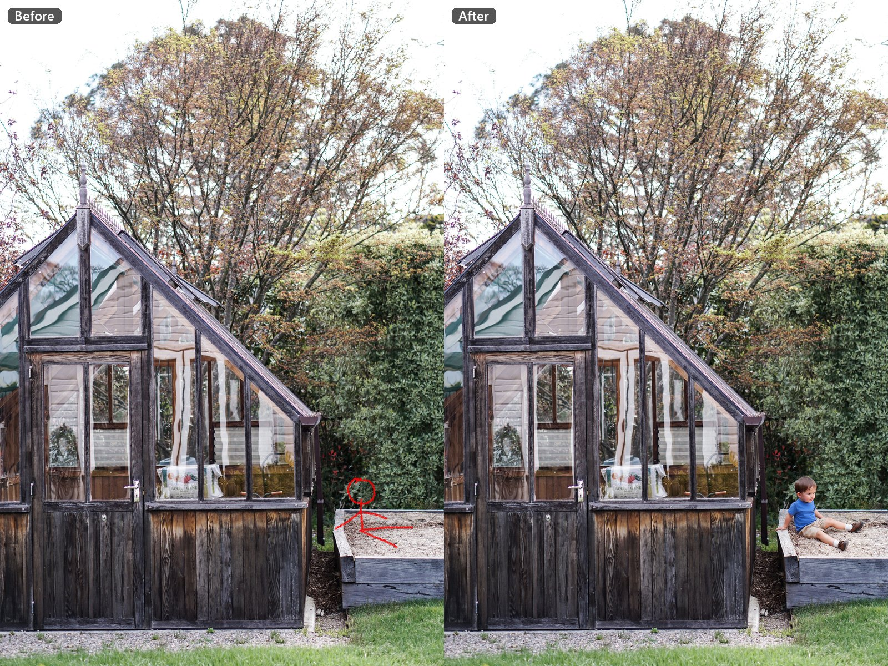</a><br><small>Flux 3 Klein Edit · “a child”</small><details><summary><small>6 more</small></summary><a href="readme-images/examples/scribble-on-photo-2.jpg">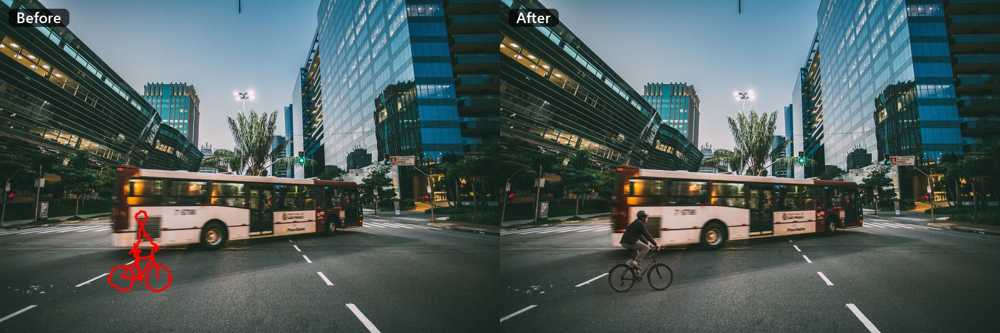</a><br><small>Flux 3 Klein Edit · “a cyclist riding a bicycle”</small><br><a href="readme-images/examples/scribble-on-photo-3.jpg">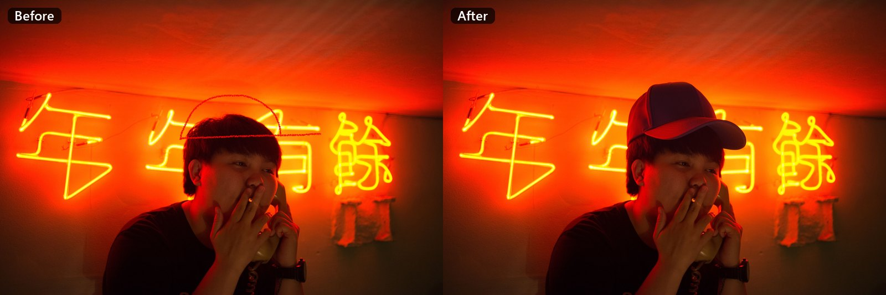</a><br><small>Flux 2 Klein Edit · “a baseball cap”</small><br><a href="readme-images/examples/scribble-on-photo-4.jpg">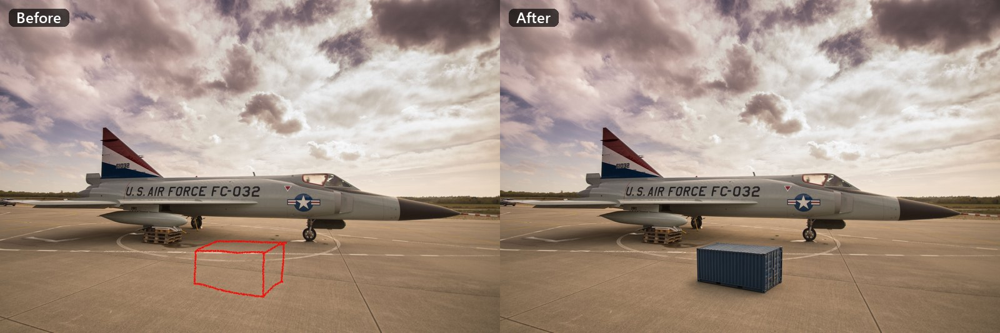</a><br><small>Qwen Image 2.1 · “a shipping container”</small><br><a href="readme-images/examples/scribble-on-photo-5.jpg">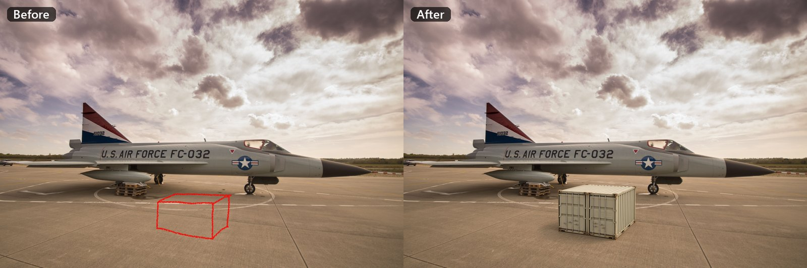</a><br><small>Fibo 2.0 Edit Turbo · “a shipping container”</small><br><a href="readme-images/examples/scribble-on-photo-6.jpg">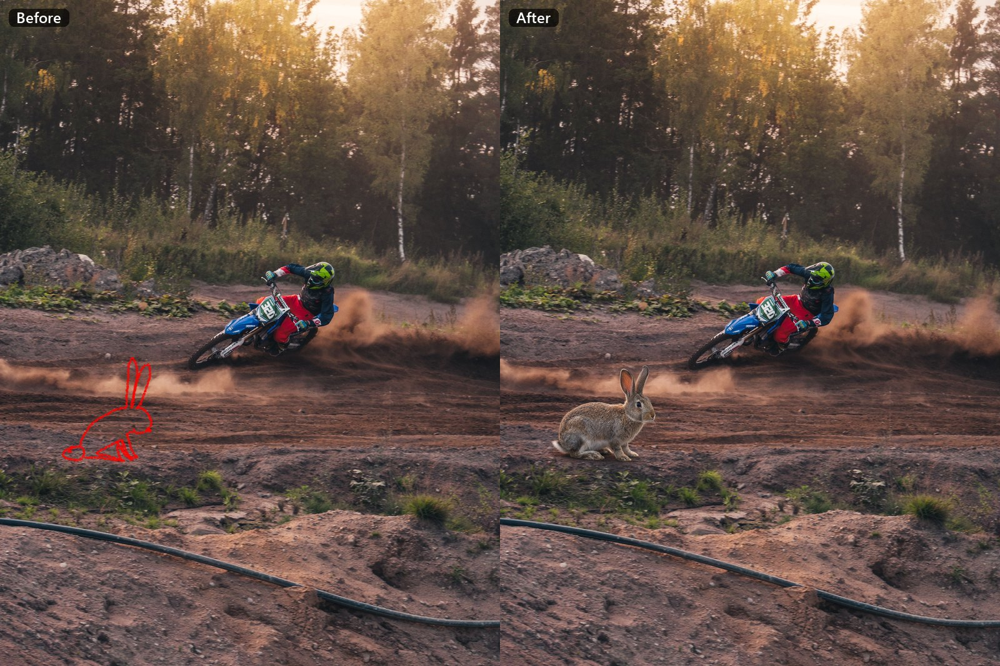</a><br><small>Fibo 2.0 Edit Turbo · “a rabbit”</small><br><a href="readme-images/examples/scribble-on-photo-7.jpg">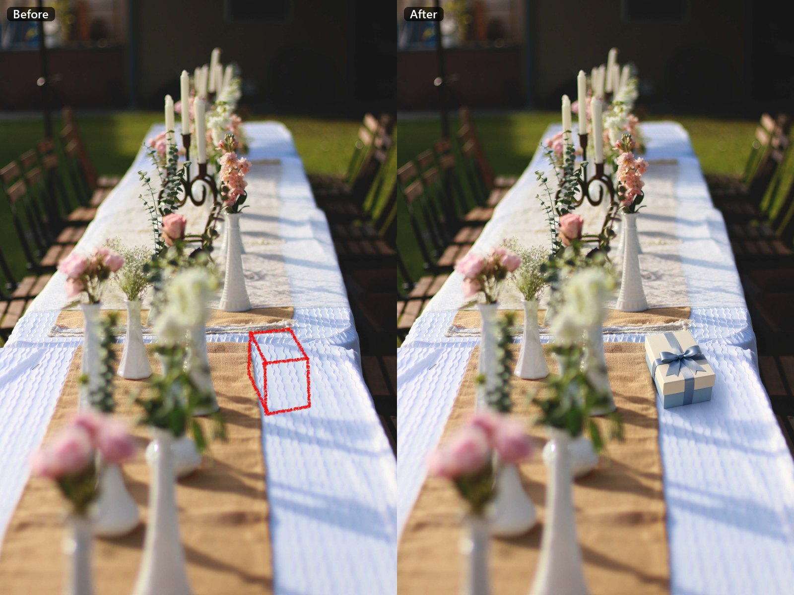</a><br><small>Qwen Image 2.1 · “a gift box”</small><br></details></td>
<td width="50%" valign="top"><b>Scribble with reference</b><br><a href="readme-images/examples/scribble-with-reference-1.jpg">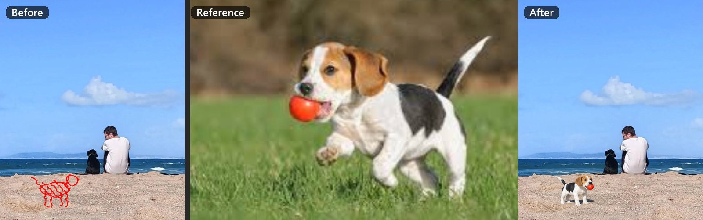</a><br><small>Qwen Image 2.1 · “beagle dog”</small><details><summary><small>2 more</small></summary><a href="readme-images/examples/scribble-with-reference-2.jpg">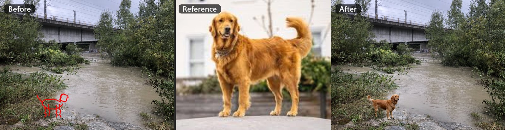</a><br><small>Flux 3 Klein Edit · “golden retriever dog”</small><br><a href="readme-images/examples/scribble-with-reference-3.jpg">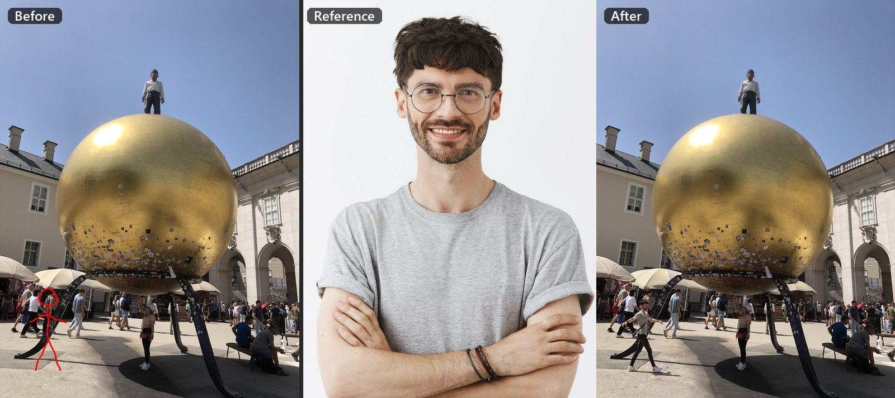</a><br><small>Flux 2 Klein Edit · “man”</small><br></details></td>
</tr>
</table>
<br>
<details>
<summary><b>More examples</b> (mixed functions, read in the order of the numbers)</summary>

<table>
<tr>
<td width="50%" valign="top"><a href="readme-images/examples/more-barn.webp">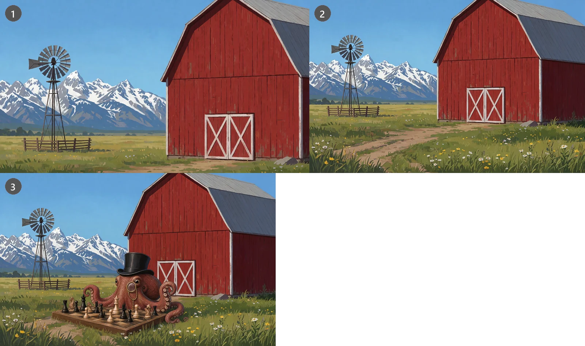</a><br><small>1 Text to image · Krea 2 Turbo → 2 Expand image · Fibo 2.0 Edit Turbo → 3 Fill Selection · Qwen Image 2.1</small></td>
<td width="50%" valign="top"><a href="readme-images/examples/more-beach-chair.webp">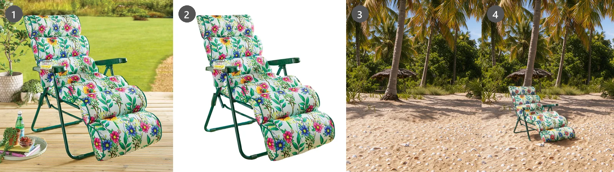</a><br><small>1 Reference → 2 Remove background → 3 Text to image · Flux 3 Klein → 4 Multi image edit · Flux 3 Klein</small></td>
</tr>
</table>
<br>
<table>
<tr>
<td width="50%" valign="top"><a href="readme-images/examples/more-beach-chest.webp">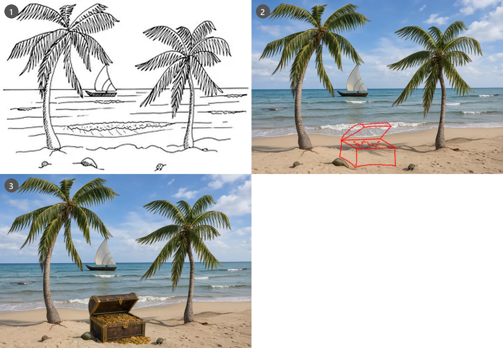</a><br><small>1 Start → 2 Sketch to image → 3 Scribble on photo</small></td>
<td width="50%" valign="top"><a href="readme-images/examples/more-chess.webp">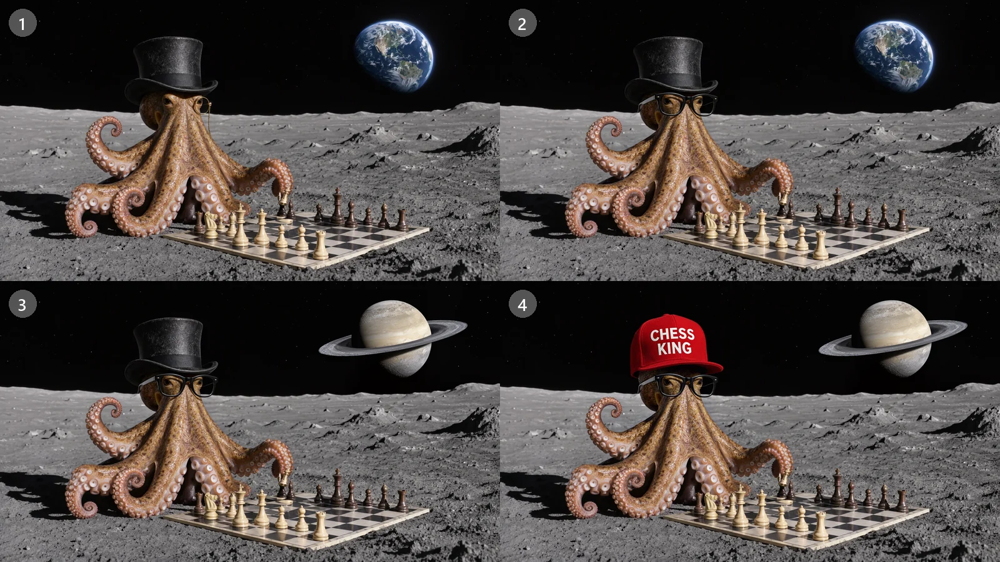</a><br><small>1 Text to image · MOSS Image → 2 Fill Selection · Fibo 2.0 Edit Turbo → 3 Fill Selection · Fibo 2.0 Edit Turbo → 4 Fill Selection · Fibo 2.0 Edit Turbo</small></td>
</tr>
</table>
<br>
<table>
<tr>
<td width="50%" valign="top"><a href="readme-images/examples/more-interior.webp">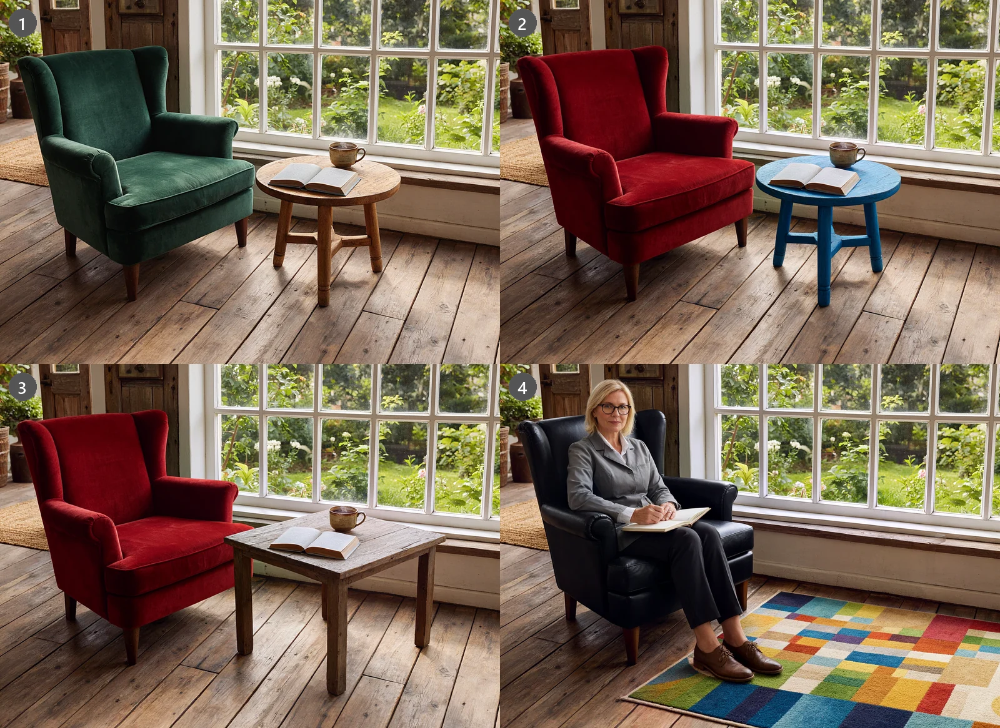</a><br><small>1 Text to image · Fibo 2.0 Edit Turbo → 2 Fill Selection · Fibo 2.0 Edit Turbo → 3 Fill Selection · Fibo 2.0 Edit Turbo → 4 Fill Selection · Fibo 2.0 Edit Turbo</small></td>
<td width="50%" valign="top"><a href="readme-images/examples/more-man.webp">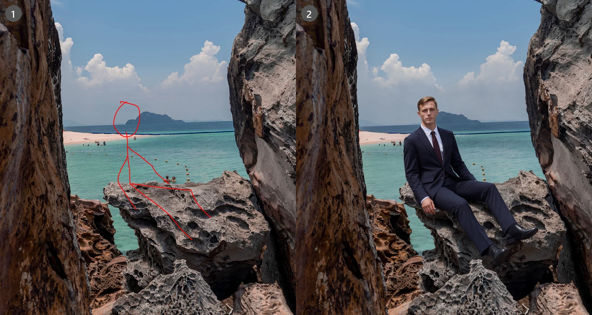</a><br><small>1 Start → 2 Scribble with reference · Flux 3 Klein</small></td>
</tr>
</table>
<br>
<table>
<tr>
<td width="50%" valign="top"><a href="readme-images/examples/more-shark.webp">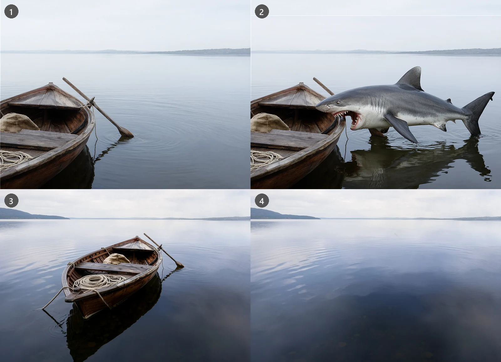</a><br><small>1 Start → 2 Fill Selection · Fibo 2.0 Edit Turbo → 3 Expand image · Qwen Image 2.1 → 4 Remove Selection · Fibo 2.0 Edit Turbo</small></td>
<td width="50%" valign="top"><a href="readme-images/examples/more-tent.webp">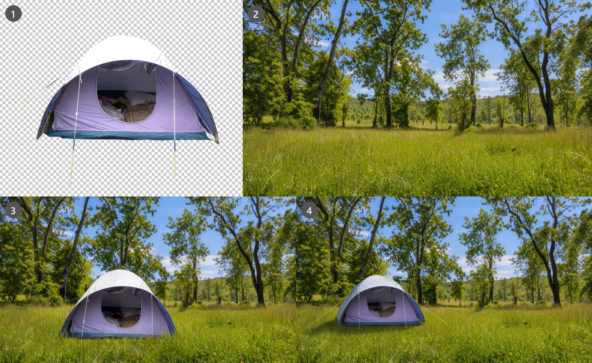</a><br><small>1 Reference → 2 Start → 3 Multi image edit · Flux 3 Klein → 4 Multi image edit · Qwen Image 2.1</small></td>
</tr>
</table>
<br>
<table>
<tr>
<td width="50%" valign="top"><a href="readme-images/examples/more-volcano.webp">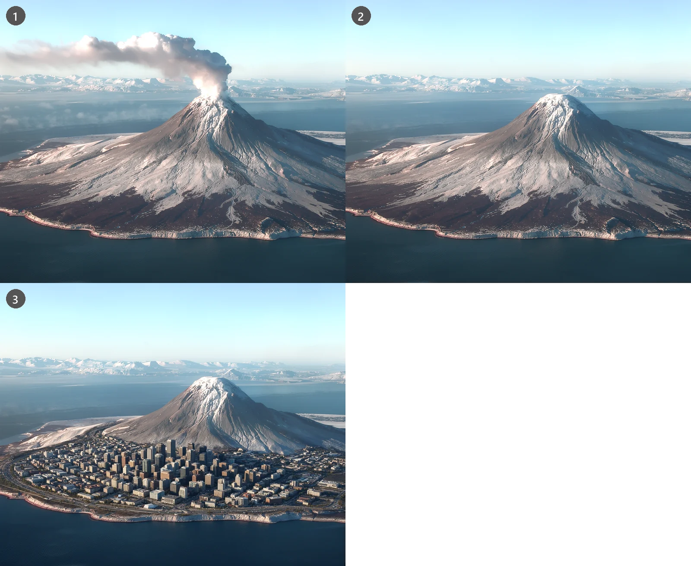</a><br><small>1 Start → 2 Remove Selection · Flux 2 Klein → 3 Fill Selection · Fibo 2.0 Edit Turbo</small></td>
<td width="50%"></td>
</tr>
</table>

</details>

<sub>Photos: Magnific, Freepik, Pexels</sub>

</details>
<!-- examples:end -->

<a id="style-prompt-examples"></a>
<details>
<summary><h2>Style prompt examples</h2></summary>

The Styles button beside the prompt adds a ready-made style text. A few of the built-in styles:

**Text to image** (91 styles in 13 groups)

- **Photo:** Tilt-shift, miniature look · Golden hour travel photo · Drone shot from above, turquoise water · Night light trails, long exposure
- **Studio & product:** Studio portrait · Business headshot · Product photo, glass on white · Food photography
- **Film look:** Film noir, teal and fog · Neon city night, bokeh · 1970s film, muted greens
- **Black & white:** Black and white, hard light and shadows · Double exposure, black and white
- **Painting:** Oil painting, 19th-century realism · Impressionist painting, sunny · Watercolor storybook · Japanese ink wash
- **Drawing & print:** Pencil gesture sketch · Etching, cross-hatched · Linocut print
- **Graphic & poster:** Mid-century travel poster · Risograph, blue and yellow · Clear-line comic · Vintage paper collage
- **Anime & comic:** Modern anime, clean lines · Anime background, golden sky · Manga, bold ink · 1930s rubber-hose cartoon
- **3D & craft:** 3D clay render · Stop-motion, felt and clay · Low-poly game look · Voxel diorama, pastel
- **Pixel & glitch:** 8-bit pixel art · VHS glitch
- **Retro & vintage:** Technicolor, 1950s print · 1980s airbrush · Synthwave, neon retro
- **Fantasy & sci-fi:** Dark fantasy, glowing neon · Cyberpunk city, neon rain · Deep space nebula
- **Surreal:** Floating objects, blue sky · Mirror lake, endless horizon

**Edit** (41 styles in 7 groups)

- **Photo:** Realistic photo · Studio portrait · Vintage black-and-white photo · Cyanotype
- **Film look:** Film look, warm dusk · Film noir, teal and fog
- **Painting:** Watercolor · Oil painting · Impressionist painting · Japanese ink wash
- **Drawing & print:** Pencil drawing · Linocut · Etching, cross-hatched
- **Anime & comic:** Animated film · Anime · Clear-line comic · Modern comic, cel shaded
- **Graphic & poster:** Flat vector · Mid-century travel poster · Risograph
- **Retro & vintage:** Pixel art · Technicolor, 1950s print · Synthwave

</details>

---

- **Six function buttons:** Text to image, Expand, Fill, Remove, Edit and Upscale / Refine. Edit has five modes:
  - Edit canvas
  - Multi image edit
  - Sketch to image
  - Scribble on photo
  - Scribble with reference

  Not every model offers every function or mode: MOSS and Krea, for example, only do Text to image.
- **Seven SOTA models:** Flux 3 Klein, Flux 2 Klein, Qwen Image 2.1, Fibo 2.0 Edit Turbo, Krea 2 Turbo, MOSS Image and the newly released MiniMax H3 Image.
- **Your own prompts:** save a prompt under a name and use it again later, with the function and model it was made for.
- **Tested settings:** every function and model starts with its tested settings; change them under Advanced settings if you like.
- **Local:** the models run in ComfyUI on your GPU.

> Unofficial community project, not affiliated with PhotoCraft, ArtCraft or Storyteller. PhotoCraft is in early alpha
> and so is this plugin.

## How it fits together

```
PhotoCraft  <-->  PxC  <-->  ComfyUI
```

- **PhotoCraft** is the image editor where you work and where the results land as layers.
- **ComfyUI** runs the AI models on your graphics card.
- **PxC** (this plugin) sits between them: it sends your picture or selection to ComfyUI and puts the result back as a layer.

## Before you start

You need (the software is free):

- **Windows 10/11 or Linux** with a GPU with at least 8 GB VRAM.
- **[PhotoCraft](https://github.com/storytold/photocraft/releases) 0.20.2 or newer**: the image editor where you work. The plugin adds AI functions to it.
- **[ComfyUI](https://github.com/comfyanonymous/ComfyUI#installing)**: runs the AI models; leave it running while you work. Flux 2 and Upscale (Flux 3, Fibo) also need the add-on [ComfyUI-KJNodes](https://github.com/kijai/ComfyUI-KJNodes) ([ComfyUI Easy Install](https://github.com/Tavris1/ComfyUI-Easy-Install) includes it).
- **[Python](https://www.python.org/downloads/windows/) 3.11 or newer** (Linux: 3.10 or newer). No Python yet? On Windows the setup offers to install it for you.
- **About 13 to 19 GB of free disk space per model you want to use, MiniMax about 38 GB** (the models are large files; one model is enough to start).

Then follow [Install on Windows](#install-on-windows) or [Install on Linux](#install-on-linux).

## Install on Windows

1. **Download**: click **Code ▸ Download ZIP** (green button at the top of this page) and unpack it to a folder you keep, for example `C:\programs\pxc`. Prefer git? See [Technical details](#technical-details).
2. **Set up**: double-click **`setup-windows.bat`**. It sets everything up and puts **PxC** on your desktop; it finds `photocraft.exe` itself and asks once if it can't. No Python yet? It offers to install Python 3.13 with one key press. If that is not possible, or you say no, it opens the download page: install Python 3.13 there with the default options ("tcl/tk" stays ticked) and run `setup-windows.bat` again. (`setup-windows.bat /check` only looks and changes nothing.)
3. **Start**: start ComfyUI, close PhotoCraft if it is open, then double-click **PxC** on your desktop. PhotoCraft opens and the plugin window appears next to it.
4. **Get a model**: in the plugin window click the gear ▸ pick a model tab ▸ **Download all model files**, then restart ComfyUI (it reads its model folders only when it starts). **Qwen Image 2.1** and **Fibo 2.0** need no login at external websites; **Flux 3 Klein** needs a free Hugging Face account once (the button opens the page; log in and accept the licence there). You can also download the files by hand: see [Model downloads](#model-downloads).
5. **Generate**: pick a function and a model, type a prompt and press **Generate** (Ctrl+Enter). The status line at the bottom tells you what is happening.

## Install on Linux

1. **System packages** (Python 3.10+ with tkinter and venv):

   ```bash
   # Debian/Ubuntu
   sudo apt install python3 python3-tk python3-venv
   # Fedora
   sudo dnf install python3 python3-tkinter
   # Arch
   sudo pacman -S python tk
   # optional, to paste pictures from the clipboard: wl-clipboard (Wayland) or xclip (X11)
   sudo apt install wl-clipboard xclip
   # only if setup-linux.sh says libXcursor is missing (needed to drag pictures onto the reference slots)
   sudo apt install libxcursor1      # Fedora: libXcursor, Arch: libxcursor
   ```

2. **Download**: click **Code ▸ Download ZIP** (green button at the top of this page) and unpack it, or use git (see [Technical details](#technical-details)).
3. **Set up**: open a terminal in the plugin folder and run `./setup-linux.sh`. It makes a private Python environment, installs the packages and adds **PxC** to your application menu. It never installs system packages itself; if something is missing it prints the command for your distribution. (`./setup-linux.sh --check` only looks and changes nothing.)
4. **Start**: start ComfyUI, close PhotoCraft if it is open, then start **PxC** from the menu (or run `./pxc.sh`). PhotoCraft is found in `PATH`, `/opt`, `~/Applications`, `~/.local/bin` or as a Flatpak. If it is somewhere else: `PHOTOCRAFT=/path/to/photocraft ./pxc.sh`.
5. **Get a model and generate**: as in steps 4 and 5 of [Install on Windows](#install-on-windows).

Window too small or too big? Gear window ▸ **Other settings** ▸ **Interface scale**.

## Model downloads

The plugin's **Download all model files** button does the same as this list. Put each file into the folder named below it, inside your ComfyUI folder (a folder like `loras/Flux 3` is a sub-folder you create), then restart ComfyUI. You only need the files of the models you want. "Optional" files switch extra features on; without them the model still works.

**Custom nodes** (small add-ons for ComfyUI; install them from the ComfyUI Manager or the link, then restart ComfyUI):
- [ComfyUI-KJNodes](https://github.com/kijai/ComfyUI-KJNodes): needed for Flux 2 and for Upscale with Flux 3 and Fibo.
- [ComfyUI-GGUF](https://github.com/city96/ComfyUI-GGUF): only for smaller GGUF model files (gear window, chain symbol).

<!-- model-downloads:start -->

<details>
<summary><b>Flux 3 Klein</b>: about 18.2 GB needed</summary>

| File and its ComfyUI folder | Needed for | Size | Download |
|---|---|---|---|
| `flux3-image-klein-int8-convrot.safetensors`<br>`models/diffusion_models` | all functions | 5.8 GB | [Hugging Face: black-forest-labs/flux-3-image-klein-comfy](https://huggingface.co/black-forest-labs/flux-3-image-klein-comfy/resolve/main/diffusion_models/flux3-image-klein-int8-convrot.safetensors) (needs a free Hugging Face login and acceptance of the licence) |
| `qwen3.5_9b_flux3_prompt_upsampler_w4a8.safetensors`<br>`models/text_encoders` | Remove, Enhance my Prompt with LLM, Describe Canvas, Describe Multi Image Slot, Sketch to image, Scribble on photo | 6.7 GB | [Hugging Face: black-forest-labs/flux-3-image-klein-comfy](https://huggingface.co/black-forest-labs/flux-3-image-klein-comfy/resolve/main/text_encoders/qwen3.5_9b_flux3_prompt_upsampler_w4a8.safetensors) (needs a free Hugging Face login and acceptance of the licence) |
| `qwen3vl_4b_int8_convrot.safetensors`<br>`models/text_encoders` | all functions | 4.9 GB | [Hugging Face: Comfy-Org/Krea-2](https://huggingface.co/Comfy-Org/Krea-2/resolve/main/text_encoders/qwen3vl_4b_int8_convrot.safetensors) |
| `flux2-vae.safetensors`<br>`models/vae` | all functions | 336 MB | [Hugging Face: Comfy-Org/Flux-2-Dev](https://huggingface.co/Comfy-Org/Flux-2-Dev/resolve/main/split_files/vae/flux2-vae.safetensors) |
| `flux-3-image-klein-outpaint.safetensors`<br>`models/loras/Flux 3` | Expand | 161 MB | [Hugging Face: ausboss/FLUX-3-Image-Klein-Outpaint-LoRA](https://huggingface.co/ausboss/FLUX-3-Image-Klein-Outpaint-LoRA/resolve/main/flux-3-image-klein-outpaint.safetensors) |
| `flux-3-image-klein-restore.safetensors`<br>`models/loras/Flux 3` | Upscale | 161 MB | [Hugging Face: ausboss/FLUX-3-Image-Klein-Restore-LoRA](https://huggingface.co/ausboss/FLUX-3-Image-Klein-Restore-LoRA/resolve/main/flux-3-image-klein-restore.safetensors) |
| `4x-UltraSharpV2.safetensors`<br>`models/upscale_models` | Upscale | 140 MB | [Hugging Face: Kim2091/UltraSharpV2](https://huggingface.co/Kim2091/UltraSharpV2/resolve/main/4x-UltraSharpV2.safetensors) |

Optional (the model works without them, the named feature is greyed out):

| File and its ComfyUI folder | Feature | Size | Download |
|---|---|---|---|
| `seedvr2_3b_int8_convrot.safetensors`<br>`models/diffusion_models` | SeedVR2 pre-cleaning in Upscale | 3.5 GB | [Hugging Face: Comfy-Org/SeedVR2](https://huggingface.co/Comfy-Org/SeedVR2/resolve/main/diffusion_models/seedvr2_3b_int8_convrot.safetensors) |
| `seedvr2_ema_vae_fp16.safetensors`<br>`models/vae` | SeedVR2 pre-cleaning in Upscale | 501 MB | [Hugging Face: Comfy-Org/SeedVR2](https://huggingface.co/Comfy-Org/SeedVR2/resolve/main/vae/seedvr2_ema_vae_fp16.safetensors) |
| `taef2_decoder.pth`<br>`models/vae_approx` | live preview | 3 MB | [GitHub: madebyollin/taesd](https://raw.githubusercontent.com/madebyollin/taesd/main/taef2_decoder.pth) |

**Custom node:** Upscale also needs the custom node pack [ComfyUI-KJNodes](https://github.com/kijai/ComfyUI-KJNodes) (Color Match). Install it from the ComfyUI Manager or the link, then restart ComfyUI.

</details>

<details>
<summary><b>Flux 2 Klein</b>: about 18.6 GB needed</summary>

| File and its ComfyUI folder | Needed for | Size | Download |
|---|---|---|---|
| `flux-2-klein-9b_int8_convrot.safetensors`<br>`models/diffusion_models` | all functions | 9.4 GB | [Hugging Face: obsxrver/ComfyUI-Native-INT8_ConvRot](https://huggingface.co/obsxrver/ComfyUI-Native-INT8_ConvRot/resolve/main/diffusion_models/flux-2-klein-9b_int8_convrot.safetensors) |
| `qwen_3_8b_fp8mixed.safetensors`<br>`models/text_encoders` | all functions | 8.7 GB | [Hugging Face: Comfy-Org/Flux-2-Klein-9B](https://huggingface.co/Comfy-Org/Flux-2-Klein-9B/resolve/main/split_files/text_encoders/qwen_3_8b_fp8mixed.safetensors) |
| `flux2-vae.safetensors`<br>`models/vae` | all functions | 336 MB | [Hugging Face: Comfy-Org/Flux-2-Dev](https://huggingface.co/Comfy-Org/Flux-2-Dev/resolve/main/split_files/vae/flux2-vae.safetensors) |
| `ultra_real_v4.safetensors`<br>`models/loras/Flux 2` | Upscale, Refine | 166 MB | [Civitai](https://civitai.com/api/download/models/2846977) (Civitai may ask you to log in) |

Optional (the model works without them, the named feature is greyed out):

| File and its ComfyUI folder | Feature | Size | Download |
|---|---|---|---|
| `qwen3vl_4b_int8_convrot.safetensors`<br>`models/text_encoders` | Enhance my Prompt with LLM, Describe Canvas, Describe Multi Image Slot, Sketch to image, Scribble on photo | 4.9 GB | [Hugging Face: Comfy-Org/Krea-2](https://huggingface.co/Comfy-Org/Krea-2/resolve/main/text_encoders/qwen3vl_4b_int8_convrot.safetensors) |
| `taef2_decoder.pth`<br>`models/vae_approx` | live preview | 3 MB | [GitHub: madebyollin/taesd](https://raw.githubusercontent.com/madebyollin/taesd/main/taef2_decoder.pth) |

**Custom node:** Upscale (always in tiles) also needs the custom node pack [ComfyUI-KJNodes](https://github.com/kijai/ComfyUI-KJNodes) (Color Match). Install it from the ComfyUI Manager or the link, then restart ComfyUI. Without it Flux 2 is locked.

</details>

<details>
<summary><b>Qwen Image 2.1</b>: about 17.3 GB needed</summary>

| File and its ComfyUI folder | Needed for | Size | Download |
|---|---|---|---|
| `qwen_image_2.1_int8_convrot.safetensors`<br>`models/diffusion_models` | all functions | 7.3 GB | [Hugging Face: Comfy-Org/Qwen-Image-2.1](https://huggingface.co/Comfy-Org/Qwen-Image-2.1/resolve/main/diffusion_models/qwen_image_2.1_int8_convrot.safetensors) |
| `qwen3vl_8b_int8_convrot.safetensors`<br>`models/text_encoders` | all functions | 9.4 GB | [Hugging Face: Comfy-Org/Qwen-Image-2.1](https://huggingface.co/Comfy-Org/Qwen-Image-2.1/resolve/main/text_encoders/qwen3vl_8b_int8_convrot.safetensors) |
| `qwen_image_2.1_vae_bf16.safetensors`<br>`models/vae` | all functions | 676 MB | [Hugging Face: Comfy-Org/Qwen-Image-2.1](https://huggingface.co/Comfy-Org/Qwen-Image-2.1/resolve/main/vae/qwen_image_2.1_vae_bf16.safetensors) |

Optional (the model works without them, the named feature is greyed out):

| File and its ComfyUI folder | Feature | Size | Download |
|---|---|---|---|
| `qwen3.5_9b_w4a8_gptq.safetensors`<br>`models/text_encoders` | Enhance my Prompt with LLM, Describe Canvas, Describe Multi Image Slot, Sketch to image, Scribble on photo | 7.3 GB | [Hugging Face: Comfy-Org/MOSS-Image](https://huggingface.co/Comfy-Org/MOSS-Image/resolve/main/text_encoders/qwen3.5_9b_w4a8_gptq.safetensors) |
| `qwen_image_2.1_turbo_lora_avg_rank_178_bf16.safetensors`<br>`models/loras/qwen` | Turbo LoRA | 913 MB | [Hugging Face: Comfy-Org/Qwen-Image-2.1](https://huggingface.co/Comfy-Org/Qwen-Image-2.1/resolve/main/loras/qwen_image_2.1_turbo_lora_avg_rank_178_bf16.safetensors) |
| `taeqi2_1_decoder.pth`<br>`models/vae_approx` | live preview | 15 MB | [GitHub: madebyollin/taesd](https://raw.githubusercontent.com/madebyollin/taesd/main/taeqi2_1_decoder.pth) |

</details>

<details>
<summary><b>Fibo 2.0</b>: about 13.7 GB needed</summary>

| File and its ComfyUI folder | Needed for | Size | Download |
|---|---|---|---|
| `fibo2_edit_turbo_int8_convrot.safetensors`<br>`models/diffusion_models` | all functions | 8.4 GB | [Hugging Face: Comfy-Org/Fibo-2.0](https://huggingface.co/Comfy-Org/Fibo-2.0/resolve/main/diffusion_models/fibo2_edit_turbo_int8_convrot.safetensors) |
| `qwen3vl_4b_int8_convrot.safetensors`<br>`models/text_encoders` | all functions | 4.9 GB | [Hugging Face: Comfy-Org/Krea-2](https://huggingface.co/Comfy-Org/Krea-2/resolve/main/text_encoders/qwen3vl_4b_int8_convrot.safetensors) |
| `flux2-vae.safetensors`<br>`models/vae` | all functions | 336 MB | [Hugging Face: Comfy-Org/Flux-2-Dev](https://huggingface.co/Comfy-Org/Flux-2-Dev/resolve/main/split_files/vae/flux2-vae.safetensors) |
| `4x-UltraSharpV2.safetensors`<br>`models/upscale_models` | Upscale | 140 MB | [Hugging Face: Kim2091/UltraSharpV2](https://huggingface.co/Kim2091/UltraSharpV2/resolve/main/4x-UltraSharpV2.safetensors) |

Optional (the model works without them, the named feature is greyed out):

| File and its ComfyUI folder | Feature | Size | Download |
|---|---|---|---|
| `taef2_decoder.pth`<br>`models/vae_approx` | live preview | 3 MB | [GitHub: madebyollin/taesd](https://raw.githubusercontent.com/madebyollin/taesd/main/taef2_decoder.pth) |

**Custom node:** The tiles option of Upscale also needs the custom node pack [ComfyUI-KJNodes](https://github.com/kijai/ComfyUI-KJNodes) (Color Match). Install it from the ComfyUI Manager or the link, then restart ComfyUI.

</details>

<details>
<summary><b>Krea 2 Turbo</b>: about 18.6 GB needed</summary>

| File and its ComfyUI folder | Needed for | Size | Download |
|---|---|---|---|
| `krea2_turbo_int8_convrot.safetensors`<br>`models/diffusion_models` | all functions | 13.5 GB | [Hugging Face: Comfy-Org/Krea-2](https://huggingface.co/Comfy-Org/Krea-2/resolve/main/diffusion_models/krea2_turbo_int8_convrot.safetensors) |
| `qwen3vl_4b_int8_convrot.safetensors`<br>`models/text_encoders` | all functions | 4.9 GB | [Hugging Face: Comfy-Org/Krea-2](https://huggingface.co/Comfy-Org/Krea-2/resolve/main/text_encoders/qwen3vl_4b_int8_convrot.safetensors) |
| `qwen_image_vae.safetensors`<br>`models/vae` | all functions | 254 MB | [Hugging Face: Comfy-Org/Krea-2](https://huggingface.co/Comfy-Org/Krea-2/resolve/main/vae/qwen_image_vae.safetensors) |

Optional (the model works without them, the named feature is greyed out):

| File and its ComfyUI folder | Feature | Size | Download |
|---|---|---|---|
| `lighttaew2_1.safetensors`<br>`models/vae_approx` | live preview | 45 MB | [Hugging Face: lightx2v/Autoencoders](https://huggingface.co/lightx2v/Autoencoders/resolve/main/lighttaew2_1.safetensors) |

</details>

<details>
<summary><b>MOSS Image</b>: about 13.1 GB needed</summary>

| File and its ComfyUI folder | Needed for | Size | Download |
|---|---|---|---|
| `moss_image_sft_int8_convrot.safetensors`<br>`models/diffusion_models` | all functions | 5.4 GB | [Hugging Face: Comfy-Org/MOSS-Image](https://huggingface.co/Comfy-Org/MOSS-Image/resolve/main/diffusion_models/moss_image_sft_int8_convrot.safetensors) |
| `qwen3.5_9b_w4a8_gptq.safetensors`<br>`models/text_encoders` | all functions | 7.3 GB | [Hugging Face: Comfy-Org/MOSS-Image](https://huggingface.co/Comfy-Org/MOSS-Image/resolve/main/text_encoders/qwen3.5_9b_w4a8_gptq.safetensors) |
| `flux2-vae_small.safetensors`<br>`models/vae` | all functions | 250 MB | [Hugging Face: Comfy-Org/MOSS-Image](https://huggingface.co/Comfy-Org/MOSS-Image/resolve/main/vae/flux2-vae_small.safetensors) |
| `lenovo_moss.safetensors`<br>`models/loras/Moss` | Text to image | 65 MB | [Hugging Face: Danrisi/lenovo_moss](https://huggingface.co/Danrisi/lenovo_moss/resolve/main/lenovo_moss.safetensors) |

Optional (the model works without them, the named feature is greyed out):

| File and its ComfyUI folder | Feature | Size | Download |
|---|---|---|---|
| `lora_dmd2.safetensors`<br>`models/loras/Moss` | Turbo LoRA | 1.2 GB | [Hugging Face: lodestones/MOSS-Image-Base-8-steps-dmd](https://huggingface.co/lodestones/MOSS-Image-Base-8-steps-dmd/resolve/main/lora_dmd2.safetensors) |
| `taef2_decoder.pth`<br>`models/vae_approx` | live preview | 3 MB | [GitHub: madebyollin/taesd](https://raw.githubusercontent.com/madebyollin/taesd/main/taef2_decoder.pth) |

</details>

<details>
<summary><b>MiniMax H3 Image</b>: about 37.8 GB needed</summary>

| File and its ComfyUI folder | Needed for | Size | Download |
|---|---|---|---|
| `minimax_h3_image_pruned_int8_convrot.safetensors`<br>`models/diffusion_models` | all functions | 21.0 GB | [Hugging Face: Comfy-Org/MiniMax-H3-Image](https://huggingface.co/Comfy-Org/MiniMax-H3-Image/resolve/main/diffusion_models/minimax_h3_image_pruned_int8_convrot.safetensors) |
| `qwen3vl_32b_minimax_h3_nvfp4_awq.safetensors`<br>`models/text_encoders` | all functions | 15.7 GB | [Hugging Face: Comfy-Org/MiniMax-H3-Image](https://huggingface.co/Comfy-Org/MiniMax-H3-Image/resolve/main/text_encoders/qwen3vl_32b_minimax_h3_nvfp4_awq.safetensors) |
| `minimax_h3_image_vae_fp16.safetensors`<br>`models/vae` | all functions | 1.2 GB | [Hugging Face: Comfy-Org/MiniMax-H3-Image](https://huggingface.co/Comfy-Org/MiniMax-H3-Image/resolve/main/vae/minimax_h3_image_vae_fp16.safetensors) |

Optional (the model works without them, the named feature is greyed out):

| File and its ComfyUI folder | Feature | Size | Download |
|---|---|---|---|
| `qwen3.5_9b_w4a8_gptq.safetensors`<br>`models/text_encoders` | Enhance my Prompt with LLM, Describe Canvas, Describe Multi Image Slot | 7.3 GB | [Hugging Face: Comfy-Org/MOSS-Image](https://huggingface.co/Comfy-Org/MOSS-Image/resolve/main/text_encoders/qwen3.5_9b_w4a8_gptq.safetensors) |

</details>

<details>
<summary><b>Remove background</b> (scissors button, optional)</summary>

| File and its ComfyUI folder | Feature | Size | Download |
|---|---|---|---|
| `birefnet.safetensors`<br>`models/background_removal` | Cut out, remove background | 444 MB | [Hugging Face: Comfy-Org/BiRefNet](https://huggingface.co/Comfy-Org/BiRefNet/resolve/main/background_removal/birefnet.safetensors) |
| `rmbg-2.0.safetensors`<br>`models/background_removal` | Remove background (second model) | 885 MB | [Hugging Face: chflame163/ComfyUI_LayerStyle](https://huggingface.co/chflame163/ComfyUI_LayerStyle/resolve/main/ComfyUI/models/BiRefNet/RMBG-2.0/model.safetensors) |

RMBG-2.0 is a community copy of the official file, which needs a Hugging Face login ([official page](https://huggingface.co/briaai/RMBG-2.0)).

</details>

<!-- model-downloads:end -->

## Functions

You pick a **function** at the top, type a prompt and press **Generate**. The plugin sends the picture (or the selection)
to ComfyUI and puts the result back into PhotoCraft as a new layer in a group, with a soft layer mask where that makes sense.

| Function | What it does |
|---|---|
| **Text to image** | A new picture from text only, as a new layer. MiniMax draws 4 to 20 MP: a new document, or with "Downsize to canvas" a layer. |
| **Expand image** | Extend the canvas with the Crop tool, fill the new area white; the plugin paints it. |
| **Fill Selection** | Select an area, type what should appear there. With Flux 3 the tab Insert reference beside it puts one reference image into your rectangle selection. |
| **Remove Selection** | Select an object, with a little margin around it, and name it in the prompt field ("car"); it is removed and the background filled in. With Flux 3, Flux 2 and Fibo you can leave the field empty: the model then names the subject itself. |
| **Edit** › Edit canvas | Changes the whole picture from your text ("make it night"). **Style prompts** turns the picture into a style (painting, comic, film look …): it sets the whole sentence in the prompt. |
| **Edit** › Multi image edit | Edits the picture with reference images (drop or paste images into the slots). A click on the tag on a slot puts it where your cursor is in the prompt, or at the end. |
| **Edit** › Sketch to image | Turns a sketch on the canvas into a picture in the style you choose under **Style prompts** (photo, film look, painting, comic, 3D and more). The style's whole text stands in the prompt: replace `<WHAT IT SHOWS>`; the style you chose last comes back next time. Needs the model's prompt writer file (see [Model downloads](#model-downloads)); without it only this tab is greyed out. |
| **Edit** › Scribble on photo | Turns scribbles on a photo into real objects: scribble in bright red or green, or on a layer of its own; only that place changes. Replace `<WHAT IT SHOWS>` in the prompt with what goes there. Needs the same files as Sketch to image. |
| **Edit** › Scribble with reference | Like Scribble on photo, but the scribbled place becomes the object of the reference picture in the slot. Replace `<WHAT IS IN THE REFERENCE>` with what it shows ("a beagle dog"). |
| **Upscale / Refine** | Pick a factor (1.5x to 4x) in the row "Upscale factor": the whole picture is enlarged into a new document, up to 16 MP. Or pick a button in the row "Refine" (Default; with Flux 2 also Neutral and Studio portrait; with Flux 3 also Restore): the picture is cleaned up at the same size, as a new layer. A selection is ignored. |

<details>
<summary>Which model offers which function</summary>

| | Flux 3 | Flux 2 | Qwen Image 2.1 | Fibo | Krea 2 | MOSS | MiniMax |
|---|:-:|:-:|:-:|:-:|:-:|:-:|:-:|
| Fill Selection | ✓ | ✓ | ✓ | ✓ | | | |
| Fill › Insert reference | ✓ | | | | | | |
| Remove Selection | ✓ | ✓ | ✓ | ✓ | | | |
| Expand image | ✓ | ✓ | ✓ | ✓ | | | |
| Edit › Edit canvas | ✓ | ✓ | ✓ | ✓ | | | ✓ |
| Edit › Multi image edit | ✓ | ✓ | ✓ | ✓ | | | ✓ |
| Upscale (new file) | ✓ | ✓ | ✓ | ✓ (up to 3x) | | | |
| Refine (same size) | ✓ | ✓ | ✓ | ✓ | | | |
| Edit › Sketch to image | ✓ | ✓ | ✓ | ✓ | | | |
| Edit › Scribble on photo | ✓ | ✓ | ✓ | ✓ | | | |
| Edit › Scribble with reference | ✓ | ✓ | ✓ | | | | |
| Text to image | ✓ | ✓ | ✓ | ✓ | ✓ | ✓ | ✓ |

</details>

**More in the window:**
- **Variants:** several results as layers in one group.
- **Last runs:** the clock at the bottom right brings back earlier settings.
- **Style prompts**, **Enhance my Prompt with LLM** and a **live preview**.
- **Remove background:** the scissors at the bottom right offer **BiRefNet**, **RMBG-2.0** or **Both**. A copy of the picture is added as a new layer with an editable layer mask that hides the background. It needs the optional files under [Model downloads](#model-downloads) ▸ Remove background.
- **Check files** (gear window ▸ Model Links) compares the model files on your disk with their checksums; a damaged file is named, never deleted.
- **Advanced settings:** edge feather, context size, mask density, custom LoRAs, prompt writer seed.

## Help

| You see | What to do |
|---|---|
| The dot next to **ComfyUI** (bottom left) is red, or "ComfyUI not connected" | Start ComfyUI. If it runs on another address or port: gear ▸ **Other settings** ▸ **ComfyUI address**, then Refresh. |
| "PhotoCraft not found" when you start | Windows: run `.venv\Scripts\python.exe -m pccomfy shortcut --photocraft "C:\path\to\photocraft.exe"` in the plugin folder (type `powershell` into Explorer's address bar). Linux: `PHOTOCRAFT=/path/to/photocraft ./pxc.sh`. |
| "PhotoCraft did not open the control port" | Another PhotoCraft is already running: close all of them and start through the shortcut or menu entry. Or another program uses port 7878. |
| "No control-channel token" or "rejected the token" | PhotoCraft was started without the plugin's start options. Close it and start through the shortcut or menu entry. Flatpak: see [Technical details](#technical-details). |
| "You need to download …" | Open the gear window and download the missing file, then restart ComfyUI (it reads its model folders only at start). |
| A Flux 3 download is refused | Log in to Hugging Face and accept the licence on the model page first. |
| On Linux nothing appears | Run `./pxc.sh` in a terminal; the message tells you what is missing. |
| **Enhance my Prompt with LLM** is slow, especially with 8 GB of VRAM | Start ComfyUI with the option `--use-ck-attention` (Comfy Kitchen attention): add it at the end of the line with `main.py` in your ComfyUI start file (`.bat`), or run `python main.py --use-ck-attention`. In our tests on 8 GB the prompt writers ran 2 to 5 times faster, Qwen Image 2.1 pictures about 25 % faster, with the same quality of prompts and pictures (tested with ComfyUI 0.45). On 16 GB the prompt writers are fast without it. |

**Update.** Download the new ZIP and unpack it over the old folder, or run `git pull` in the plugin folder if you used `git clone`; then run the setup script again and restart the plugin. Your settings stay in `data\` (Linux: `~/.config/pccomfy/`) and are not touched.

**Report a problem.** Open an issue on this repository's **Issues** page and tell us:
- what you did, what you expected and what happened (the status line at the bottom of the window is useful);
- the **report** of the plugin: gear window ▸ **Other settings** ▸ **Copy report**, then paste it into the issue. It lists the plugin version, Python, your settings and what ComfyUI and PhotoCraft answered; it contains no prompts and no access tokens.

If we ask for more: the last lines of `data\exchange\runs.jsonl` (Linux: `~/.cache/pccomfy/exchange/runs.jsonl`) have one line per run, and `last-graph.json` in the same folder is the exact request sent to ComfyUI. Both can contain your prompts, so look through them before you post.

## Technical details

**Install with git.** Copy the address from the green **Code** button at the top of this page, then:

```bash
git clone <address>
cd pxc
```

**Windows, by hand** (what `setup-windows.bat` does):

```bat
py -3.13 -m venv .venv
.venv\Scripts\python.exe -m pip install -r requirements.txt
:: desktop shortcut (optional)
.venv\Scripts\python.exe -m pccomfy shortcut --photocraft "C:\path\to\photocraft.exe"
:: start without the shortcut (ComfyUI running, PhotoCraft closed)
.venv\Scripts\python.exe pxc.pyw --photocraft "C:\path\to\photocraft.exe"
```

If `setup-windows.bat` said it uses Python directly, use the path in `data\python.txt` instead of `.venv\Scripts\python.exe`.
The shortcut starts PhotoCraft with a control channel for the plugin (local only, protected by a token, file access limited to `data\exchange`) and then the plugin, without a console window.

**Linux, by hand** (what `setup-linux.sh` does):

```bash
# create the venv with the system Python: a Python from uv or pyenv brings a Tk that does not draw the Inter font
/usr/bin/python3 -m venv .venv
.venv/bin/pip install -r requirements.txt
./pxc.sh
# menu entry (optional)
.venv/bin/python -m pccomfy shortcut --photocraft /path/to/photocraft
```

Settings and the PhotoCraft token live in `~/.config/pccomfy/`. A different ComfyUI address or port goes into `~/.config/pccomfy/config.toml` (see `config.example.toml`). `.venv/bin/python -m pccomfy scale` shows how the plugin detected the display scale.

**PhotoCraft as a Flatpak.** It is found by itself; to name it: `PHOTOCRAFT=flatpak:ai.storyteller.photocraft ./pxc.sh`. The Flatpak sandbox sees only Pictures and Documents, so the plugin opens `~/.config/pccomfy` and `~/.cache/pccomfy` for the Flatpak run; that lets PhotoCraft write its token file there.

**Model files.** All files with sizes, folders and links are listed under [Model downloads](#model-downloads). The gear window lists the same files with a download button; the plugin enables a model when it finds all the files for its standard settings. To keep the memory use low, release 1 uses int8 ConvRot files for most models; the exceptions are the text encoders of MiniMax (nvfp4) and Flux 2 (fp8mixed) and the prompt writers (w4a8). Some files are gated: log in to Hugging Face and accept the licence on the model page first. Flux 3 is one of them.

**Known limitations.**
- Developed and tested on Windows 11 with an NVIDIA card. On Linux it was run on Ubuntu 24.04 (Wayland) and Linux Mint (X11); other distributions are not tested yet.
- Linux: under X11 the window stays above PhotoCraft and minimises with it; under Wayland it is a normal window that stays on top.
- During a run, PhotoCraft briefly opens a temporary document. Please don't switch documents or change the selection while a run is going.
- A run consists of several PhotoCraft steps (history entries).
- CMYK, Lab and 16-bit documents go through 8-bit RGB.

## License

Dual-licensed under [MIT](LICENSE-MIT) or [Apache-2.0](LICENSE-APACHE), at your option. The models are not part of this
repository and have their own licences (on each model's page).
